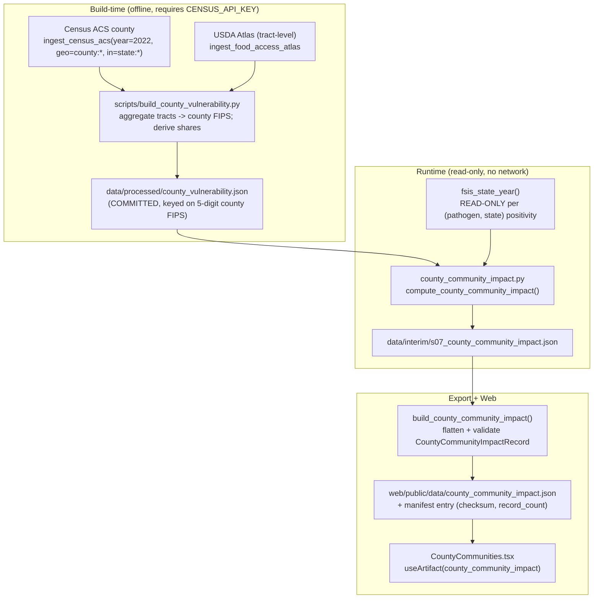

# Design Document

## Overview

**S07 — County Community Impact** is a new, deterministic overlay module that produces a per-**county** vulnerability-aware priority ranking per pathogen (Salmonella, Listeria, STEC). It is a finer-geographic-resolution companion to the existing state-level S06 module (`src/analysis/community_impact.py`), which S07 leaves entirely untouched.

The central, deliberately-exposed honesty constraint shapes every part of this design: **the two sides of the ranking join have different native resolutions.**

- The **vulnerability side is county-level.** Census ACS 5-year resolves at county grain; the USDA Food Access Research Atlas is census-tract-level and can be aggregated to county by the 5-digit county FIPS (state 2 digits + county 3 digits).
- The **hazard side is state-only.** FSIS laboratory-sampling positivity carries an establishment state, not a county. There is no honest sub-state hazard.

Therefore a county priority ranking combines **county vulnerability** with that county's **state-level hazard**. Every county in a given state shares that state's single hazard value. This mismatch is labeled explicitly — on every record (`resolution_label = "county vulnerability x state-level hazard"`) and prominently in the UI. S07 never implies county contamination, county infection, or a county-measured hazard, and performs **no new modeling**: it reuses the read-only FSIS state hazard (`fsis_state_year()`) and the S06 weighting/lens conventions at county grain.

The reproducibility strategy mirrors the facility-map geocode cache (`data/external/facility_geocode.json`): a **committed county vulnerability table** is built once by a maintainer who holds a `CENSUS_API_KEY`, then committed so a reviewer *without* a key still sees real county vulnerability. The runtime compute path reads only the committed table and makes no network call. Absent both the table and a key, S07 degrades honestly (unavailable, `skipped_no_key` gap, nothing fabricated).

### What S07 does and does not do

| Does | Does not |
| --- | --- |
| Reuses read-only state hazard via `fsis_state_year()` | Modify S06 code, cache, artifact, or tests |
| Normalizes hazard over the STATE set, vulnerability over the COUNTY set | Re-rank the state hazard at county level |
| Produces one hazard value per (pathogen, county) from the county's state | Claim a county-measured hazard or county infection |
| Reads a committed county vulnerability table at runtime | Call Census/Atlas over the network at runtime |
| Retains unavailable counties with a reason | Drop or fabricate counties/lenses |

## Architecture

S07 has three stages, matching the project's established ingest -> compute -> export -> web pattern:

1. **Build-time (offline, key-holder only):** `scripts/build_county_vulnerability.py` pulls county ACS + county-aggregated Atlas once and writes the committed `data/processed/county_vulnerability.json`, which is committed to the repository.
2. **Compute (runtime, read-only):** `src/analysis/county_community_impact.py` reads the committed table + the read-only state hazard, maps each county to its state, normalizes the two components under the two documented scopes, computes per-lens `priority_score`, weight-sensitivity, and writes its own cache `data/interim/s07_county_community_impact.json`.
3. **Export + web:** `build_county_community_impact()` in `src/artifacts/exporter.py` flattens the cache into validated `CountyCommunityImpactRecord` rows written to `web/public/data/county_community_impact.json`; the `CountyCommunities` web view renders them.



### Normalization scopes (the key honest decision)

Two documented, testable constants fix where each component's min-max normalization happens:

- `HAZARD_NORMALIZATION_SCOPE = "state"` — `Hazard_Component` is min-max normalized over the **STATE** set (its native grain), then assigned to every county in that state. The state hazard is never re-ranked at county level.
- `VULNERABILITY_NORMALIZATION_SCOPE = "county"` — `Vulnerability_Component` is min-max normalized over the **COUNTY** set.

This separation is what makes Property 2 hold: two counties in the same state and pathogen necessarily share an identical `hazard_component` and `hazard_positivity`.

## Components and Interfaces

### 1. County vulnerability build step (offline, key-holder only)

A new `scripts/build_county_vulnerability.py` and a companion builder function produce the committed table exactly once. This is the only place a network ACS/Atlas pull happens; it is **never** invoked by the runtime compute/export path (mirroring `scripts/build_facility_geocode.py`).

```python
# scripts/build_county_vulnerability.py
def build_county_vulnerability_table(*, acs_year: int = 2022) -> dict:
    """OFFLINE build (requires CENSUS_API_KEY). Pull county ACS + tract Atlas,
    aggregate to county FIPS, derive shares, write data/processed/county_vulnerability.json.
    NEVER called by the runtime exporter/compute path."""
```

**County ACS pull.** The existing `ingest_census_acs(year, variables, geo)` builds params `{"get","for","key"}` with `for=geo`. The Census county endpoint needs an additional `in=state:*` predicate. The design **extends `ingest_census_acs` to accept an optional `in_clause: Optional[str] = None`** and, when set, adds `params["in"] = in_clause`; S06's existing `geo="state:*"` call is unaffected (the new parameter defaults to `None`). The county pull is:

```python
ingest_census_acs(
    year=2022,
    variables=["B01001_001E",                       # total population
               "B01001_020E","B01001_021E","B01001_022E",
               "B01001_023E","B01001_024E","B01001_025E",   # male 65+
               "B01001_044E","B01001_045E","B01001_046E",
               "B01001_047E","B01001_048E","B01001_049E"],  # female 65+
    geo="county:*", in_clause="state:*",
)
```

`elderly_65plus_share` is derived honestly as `(sum of the twelve 65+ cells) / B01001_001E`, consistent with the partial 65+ proxy S06 uses in `harmonize_census_acs`. `county_fips` = the ACS `state` (2 digits, zero-padded) concatenated with `county` (3 digits, zero-padded).

**County Atlas aggregation.** The Atlas is tract-level. Each tract's 11-digit `CensusTract` FIPS is truncated to its 5-digit county prefix (`state2 + county3`). The build aggregates tracts to county as **tract-count shares** (share of a county's tracts flagged), consistent with how S06 defines `lila_tract_share`/`low_income_tract_share` but at county grain rather than state grain:

- `low_access_share` = count of LILA-flagged tracts in the county / total tracts in the county.
- `low_income_share` = count of low-income-flagged tracts in the county / total tracts in the county.

The design documents the chosen share definition (tract-count shares) explicitly in the committed table and in the record `method_version`. S07 **does not** reuse S06's state aggregation (`harmonize_food_access` / `harmonize_census_acs`) as the county source (Req 10.4).

### 2. Committed county vulnerability table

`data/processed/county_vulnerability.json` — committed, reviewer-visible, keyed on 5-digit county FIPS:

```jsonc
{
  "acs_vintage": "ACS5 2022",
  "atlas_vintage": "FARA/LRAM 2019",
  "share_definition": "tract-count shares aggregated to 5-digit county FIPS",
  "counties": {
    "06037": {
      "county_fips": "06037",
      "county_name": "Los Angeles County",
      "state": "CA",
      "total_population": 10014009.0,
      "elderly_65plus_share": 0.1374,
      "low_income_share": 0.41,
      "low_access_share": 0.22
    }
    // ... one entry per county covered
  }
}
```

### 3. The S07 compute module

`src/analysis/county_community_impact.py` mirrors S06's structure, with distinct constants so S06 is never touched:

```python
from src.analysis.human_comparison import fsis_state_year  # READ-ONLY reuse

REPO_ROOT = Path(__file__).resolve().parents[2]
INTERIM_DIR = REPO_ROOT / "data" / "interim"
CACHE_PATH = INTERIM_DIR / "s07_county_community_impact.json"   # DISTINCT from S06
COUNTY_VULN_PATH = REPO_ROOT / "data" / "processed" / "county_vulnerability.json"

MODULE_ID = "S07"
METHOD_VERSION = "s07.v1"

# Reused from S06's conventions (re-declared locally to avoid coupling to S06 internals).
DEFAULT_WEIGHTS = (0.6, 0.4)                 # (hazard, vulnerability)
ALT_WEIGHT_SETS = [(0.5, 0.5), (0.4, 0.6)]
LENS_FIELDS = {                               # data-backed county lenses
    "elderly_65plus": "elderly_65plus_share",
    "low_income": "low_income_share",
    "low_access": "low_access_share",
}
UNAVAILABLE_LENSES = {                         # shown unavailable, never fabricated
    "under5": "Under-5 share is not in the S07 county ACS pull.",
    "pregnancy": "Pregnancy/newborn counts are not available in the county ACS extraction.",
}

# The two documented, testable normalization scopes (the key honest decision).
HAZARD_NORMALIZATION_SCOPE = "state"   # native state grain; assigned to each county
VULNERABILITY_NORMALIZATION_SCOPE = "county"

RESOLUTION_LABEL = "county vulnerability x state-level hazard"

def state_hazard() -> dict[str, dict[str, float]]:
    """READ-ONLY per-(pathogen, state) positivity, reused unchanged from S04/S05
    via fsis_state_year(). S07 never mutates the shared source (Req 11.4)."""

def load_county_vulnerability() -> Optional[dict[str, dict]]:
    """Read the committed county_vulnerability.json. Returns None when absent
    (never geocodes/pulls). Malformed/non-5-digit FIPS keys are skipped with a gap."""

def county_to_state(county_fips: str) -> Optional[str]:
    """Map a 5-digit county FIPS to its USPS state via the first two digits
    (reuses harmonize.state_from_fips)."""

def minmax_component(values: dict[str, Optional[float]]) -> dict[str, Optional[float]]:
    """Min-max over the given set to [0,1]; None skipped (never imputed). Mirrors S06."""

def priority_score(hazard_c, vuln_c, weights) -> Optional[float]:
    """round(w_h*hazard_c + w_v*vuln_c, 6); None when either component is None
    (never a hazard-only or vulnerability-only score). Mirrors S06 priority_score exactly."""

def weight_sensitivity(hazard_comp, vuln_comp, *, top_k: int = 5) -> dict:
    """Top-K counties under DEFAULT_WEIGHTS vs ALT_WEIGHT_SETS; rank_stable + note."""

def compute_county_community_impact(*, round_to: int = 6) -> dict:
    """Load committed county vulnerability + read-only state hazard; map county->state;
    normalize hazard over STATE scope and vulnerability over COUNTY scope; compute per-lens
    priority_score; stamp status OBSERVED, geography_level 'county' (hazard labeled state-level);
    record gaps; write CACHE_PATH with json.dumps(indent=2, sort_keys=True)."""

def load_cache() -> Optional[dict]:
    """Mirror S06 load_cache: read CACHE_PATH, tolerate (OSError, ValueError) -> None."""
```

**Compute flow inside `compute_county_community_impact`:**

1. `county_vuln = load_county_vulnerability()`. If `None` and no `CENSUS_API_KEY`: record a `skipped_no_key` gap, set every county unavailable (Req 3.1, 3.2) — but continue.
2. `hz = state_hazard()`.
3. Build the county set; map each `county_fips -> state` (malformed FIPS -> gap + that county unavailable, Req 3.6).
4. For each pathogen: `hazard_comp_by_state = minmax_component({state: hz_p[state]})` over the **STATE** scope; assign each county its state's component (Property 2).
5. `vuln_comp_by_county[lens] = minmax_component({fips: county_vuln[fips][field]})` over the **COUNTY** scope.
6. Per county, per lens: `priority_score(hazard_comp, vuln_comp, DEFAULT_WEIGHTS)`.
7. `affected_population_context = round(low_access_share * total_population, 2)` when both present, else `None` (Req 8).
8. `weight_sensitivity` over top-K counties by priority (default vs alt).
9. Counties with no state hazard for the pathogen, or no vulnerability profile, are **retained** as `unavailable` with a reason (Req 5).
10. Write `CACHE_PATH` deterministically (`indent=2, sort_keys=True`).

### 4. The exporter builder

`build_county_community_impact()` in `src/artifacts/exporter.py` mirrors `build_community_impact()`:

```python
def build_county_community_impact() -> list[dict]:
    """S07: OBSERVED county vulnerability x state-level hazard ranking.
    Reads s07_county_community_impact.json, flattens to CountyCommunityImpactRecord,
    stamps artifact_version/module_id='S07'/method_version/generated_at (resolve_generated_at).
    If the cache is missing, returns explicit per-pathogen unavailable records."""
    from src.analysis.county_community_impact import load_cache
```

- Import `CountyCommunityImpactRecord` (and reuse `LensPriority`/`WeightSensitivity`) into the existing `from src.artifacts.schemas import (...)` block.
- In `build_all_artifacts()`: `county_community_impact = build_county_community_impact()` then `validate_payload(county_community_impact, CountyCommunityImpactRecord, label="county_community_impact")`; add `"county_community_impact": county_community_impact` to the returned mapping so it is written to `web/public/data/county_community_impact.json` with a manifest entry (checksum + record_count).
- Rows sorted by `(pathogen, county_fips)` for determinism (Property 9).
- **Forbidden-field guard (Req 2.1):** before returning, assert no row field name contains (case-insensitively) any banned token — `"county_infection"`, `"tract_infection"`, `"infection"`, `"illness_estimate"`, `"predicted_case"`, `"human_case"`.

### 5. The web view — new "County Communities" tab

**Decision: add a NEW tab** rather than a drill-down inside `VulnerableCommunities`. Rationale: (a) it keeps the locked S06 component and its tests untouched (Req 11.1), avoiding any risk of regression; (b) the county resolution-mismatch story needs its own prominent framing that would be diluted inside the state view; (c) the project already wires panels as top-level tabs, so a new tab is the lowest-surprise integration.

Wiring in `web/src/App.tsx`: extend the `Tab` union with `"countycommunities"`, import `CountyCommunities`, add a tab button, and add a render branch. `VulnerableCommunities` is not modified.

`web/src/components/panels/CountyCommunities.tsx`:

```tsx
const state = useArtifact<CountyCommunityImpactRecord[]>("county_community_impact");
// pathogen filter (Salmonella | Listeria | STEC), lens filter (elderly_65plus | low_income | low_access | under5 | pregnancy)
```

- Reuses the **maplibre fallback-grid** pattern from `MapView` (`data-testid="map-view"`, per-county `data-testid="county-row"` / `data-county` buttons) so it is jsdom-testable when WebGL is mocked in `setupTests` (Req 12.4).
- Displays the `"county vulnerability x state-level hazard"` resolution label prominently (Req 1.6), a ranked county list showing `hazard_positivity` **labeled state-level**, vulnerability, `priority_score`, and `affected_population_context` with the illustrative-count note (Req 8.4).
- Weight-sensitivity disclosure block (Req 7); `StatusTag="OBSERVED"` on values (Req 12.5); honest empty/unavailable states (artifact missing -> `EmptyState`; unavailable counties shown with reason).
- Navy/teal theme consistent with S06; any orange/red use is confined to the project's `themeDiscipline` allowlist.

Component state/props:

```tsx
type Pathogen = "Salmonella" | "Listeria" | "STEC";
function CountyCommunities(): JSX.Element;          // top-level, no props; reads the artifact
function CountyCommunitiesBody({ rows, pathogen, lens }: {
  rows: CountyCommunityImpactRecord[]; pathogen: Pathogen; lens: string;
}): JSX.Element;
```

## Data Models

### Python TypedDict (schemas.py)

Inserted **immediately before** the `#: All status-bearing literal values...` `STATUS_TAGS` anchor. `LensPriority` and `WeightSensitivity` are **reused** from S06 (their shape fits: a county lens needs exactly `lens/available/vulnerability_component/priority_score/weights/unavailable_reason`, and sensitivity needs `default_top/alt_top/rank_stable/note` — the `*_top` lists simply hold county FIPS strings instead of state codes). A new county record type is added for the county-specific fields:

```python
class CountyCommunityImpactRecord(TypedDict):
    """One (pathogen, county) vulnerability-aware impact record (S07).

    The hazard is the READ-ONLY state-level FSIS positivity for the county's
    state: `hazard_component`/`hazard_positivity` are identical for every county
    in the same state+pathogen and never county-measured. Vulnerability is
    county-level (ACS county 65+ share; Atlas county-aggregated low-income /
    low-access tract-count shares). `resolution_label` states the mismatch on
    every record. Geography is "county" for vulnerability, state-level for
    hazard. `affected_population_context` is an illustrative count (could be
    affected IF exposed), never an observed/illness count, kept distinct from
    the [0,1] shares. under5/pregnancy lenses are unavailable, never fabricated.
    `status` is OBSERVED. Independent of S06 (module_id "S07", own cache)."""

    artifact_version: str
    module_id: str                 # "S07"
    method_version: str
    pathogen: str
    commodity: str
    county_fips: str               # 5-digit (state2 + county3)
    county_name: str
    state: str                     # County_State (USPS) whose hazard was used
    geography_level: str           # "county"
    resolution_label: str          # "county vulnerability x state-level hazard"
    hazard_positivity: Optional[float]
    hazard_component: Optional[float]
    rank: Optional[int]
    affected_population_context: Optional[float]
    total_population: Optional[float]
    elderly_65plus_share: Optional[float]
    low_income_share: Optional[float]
    low_access_share: Optional[float]
    under5_share: Optional[float]  # always None (unavailable, never fabricated)
    acs_vintage: Optional[str]
    atlas_vintage: Optional[str]
    lenses: list[LensPriority]
    weight_sensitivity: Optional[WeightSensitivity]
    contextual_count_note: str
    status: StatusTag              # OBSERVED
    availability_status: str       # "available" | "unavailable"
    unavailable_reason: Optional[str]
    generated_at: str
```

### TypeScript mirror (web/src/types/artifacts.ts)

An identical snake_case interface appended after the S06 block, reusing the existing `LensPriority` and `WeightSensitivity` interfaces:

```ts
// county_community_impact -> County Communities view (S07)
export interface CountyCommunityImpactRecord {
  artifact_version: string;
  module_id: string;
  method_version: string;
  pathogen: string;
  commodity: string;
  county_fips: string;
  county_name: string;
  state: string;
  geography_level: string;
  resolution_label: string;
  hazard_positivity: number | null;
  hazard_component: number | null;
  rank: number | null;
  affected_population_context: number | null;
  total_population: number | null;
  elderly_65plus_share: number | null;
  low_income_share: number | null;
  low_access_share: number | null;
  under5_share: number | null;
  acs_vintage: string | null;
  atlas_vintage: string | null;
  lenses: LensPriority[];
  weight_sensitivity: WeightSensitivity | null;
  contextual_count_note: string;
  status: StatusTag;
  availability_status: string;
  unavailable_reason: string | null;
  generated_at: string;
}
```

A parity test (mirroring `test_facility_map.py`'s `_ts_interface_fields` approach) asserts `typing.get_type_hints(CountyCommunityImpactRecord).keys()` equals the TS interface field set.

### Committed county vulnerability table shape

As shown in Components §2: a top-level object with `acs_vintage`, `atlas_vintage`, `share_definition`, and a `counties` map keyed on 5-digit county FIPS, each value carrying `county_fips`, `county_name`, `state`, `total_population`, `elderly_65plus_share`, `low_income_share`, `low_access_share`.

## Correctness Properties

*A property is a characteristic or behavior that should hold true across all valid executions of a system — essentially, a formal statement about what the system should do. Properties serve as the bridge between human-readable specifications and machine-verifiable correctness guarantees.*

S07 is a pure, deterministic transformation (committed table + read-only hazard -> ranking) with universal invariants across inputs, so property-based testing applies. The following properties are derived from the prework classification of every acceptance criterion and reflect the redundancy reduction performed (e.g. the three "component bounded" criteria were consolidated into one bounds property; the two determinism criteria 3.4 and 6.6 were consolidated into Property 9).

### Property 1: Lens never changes the hazard

*For any* (pathogen, county) record and any choice of lens, the record's `hazard_component` and `hazard_positivity` are the same (equal after rounding to 6 decimals); only each lens's `priority_score` ordering changes.

**Validates: Requirements 4.1, 4.2**

### Property 2: Same state + pathogen implies identical hazard

*For any* two county records sharing the same `state` and `pathogen`, their `hazard_component` and `hazard_positivity` are identical. (This is the central state-hazard invariant produced by normalizing hazard over the STATE scope.)

**Validates: Requirements 1.2, 2.2**

### Property 3: Priority score is the documented weighted sum or None

*For any* (pathogen, county) lens whose `hazard_component` and `vulnerability_component` are both present, `priority_score == round(0.6*hazard_component + 0.4*vulnerability_component, 6)`; and *for any* lens where either component is None, `priority_score` is None — never a hazard-only or vulnerability-only score.

**Validates: Requirements 1.1, 4.3, 4.4, 4.5, 6.5**

### Property 4: No infection claim; OBSERVED; county vulnerability / state hazard

*For any* produced record, no field name contains (case-insensitively) any banned token (`county_infection`, `tract_infection`, `infection`, `illness_estimate`, `predicted_case`, `human_case`); `status` is always "OBSERVED"; `geography_level` is "county" and `resolution_label` is "county vulnerability x state-level hazard"; and `hazard_positivity` is the state positivity, never a county-measured value.

**Validates: Requirements 1.3, 1.4, 1.5, 2.1, 2.2, 2.3, 2.5**

### Property 5: Bounded components; affected-context is a distinct count

*For any* record, every non-None `hazard_component`, `vulnerability_component`, and `priority_score` lies in [0,1]; and `affected_population_context`, when present, equals `low_access_share * total_population` — a non-negative count (greater than 1 for any non-trivial nonzero share over a real county population) kept distinct from the [0,1] shares.

**Validates: Requirements 2.4, 2.6, 6.4, 8.1, 8.3**

### Property 6: Unavailable lenses are never fabricated

*For any* record, the `under5` and `pregnancy` lenses are present with `available=false`, a stated reason, and `vulnerability_component` and `priority_score` both None; `under5_share` is None on every record.

**Validates: Requirements 10.3**

### Property 7: All three pathogens first-class; unavailable counties retained

*For any* produced output, exactly three pathogen groups (Salmonella, Listeria, STEC) are present; every county record has `availability_status` in {"available","unavailable"}; and a county with no state hazard for the pathogen, or no vulnerability profile, is retained with `availability_status="unavailable"` and a reason — never dropped or fabricated.

**Validates: Requirements 5.1, 5.2, 5.3, 5.4, 5.5**

### Property 8: Honest key-absent / committed-table degradation

*For any* run where no committed county vulnerability table is present and no `CENSUS_API_KEY` is set, every county record is `unavailable` with a Census-key reason, a `skipped_no_key` gap is recorded, and no numeric county vulnerability value is written; *and for any* run where a valid committed table is present, counties it covers are `available` with their real values.

**Validates: Requirements 3.1, 3.2, 3.3, 3.5, 3.6**

### Property 9: Determinism (byte-identical, stable ordering)

*For any* two runs over byte-identical committed inputs (table + hazard), the written artifact bytes are identical and the records are emitted in a stable `(pathogen, county_fips)` order with identical `priority_score` values and county ordering.

**Validates: Requirements 3.4, 6.6, 6.3**

### Property 10: Component normalization respects the two documented scopes

*For any* set of counties and states, `hazard_component` equals the min-max of state positivities over the STATE set (None skipped), and each lens `vulnerability_component` equals the min-max of that lens's values over the COUNTY set (None skipped, never imputed).

**Validates: Requirements 6.1, 6.2, 6.3**

### Property 11: Vintage disclosure tracks availability

*For any* record with an available ACS-derived value, `acs_vintage` is non-None; with an available Atlas-derived value, `atlas_vintage` is non-None; and where a vulnerability value is unavailable, the corresponding vintage is None (never fabricated).

**Validates: Requirements 9.1, 9.2, 9.3**

### Property 12: Weight-sensitivity disclosure

*For any* available pathogen group, the output reports the top counties under the default weighting and at least one alternative, a `rank_stable` flag, the disclosed weight values, and a note that the ranking is weight-dependent.

**Validates: Requirements 7.1, 7.2, 7.3, 7.4**

### Property 13: Schema ↔ TypeScript field-name parity

*For any* field defined on the Python `CountyCommunityImpactRecord`, the mirrored TypeScript `CountyCommunityImpactRecord` interface defines a field of the same snake_case name, and vice versa (key-set equality).

**Validates: Requirements 12.1**

### Property 14: S06 independence

*For any* S07 run, S06's module file, cache (`s06_community_impact.json`), artifact, and tests are unmodified; S07 uses `module_id` "S07", writes only its own `s07_county_community_impact.json`, and reads the FSIS hazard without mutating the shared source.

**Validates: Requirements 11.1, 11.2, 11.3, 11.4**

## Error Handling

All error paths degrade honestly and never abort the wider export (mirroring the project's ingest/exporter conventions):

- **`CENSUS_API_KEY` absent + no committed table:** record a `{"source": "census_acs", "reason": "skipped-no-key"}` gap; set every county `unavailable` with a reason that the Census key is absent; write no numeric vulnerability; complete without raising (Req 3.1, 3.2).
- **Committed table absent (but a key present at build time is irrelevant to runtime):** runtime treats it exactly as the key-absent case — unavailable with a stated reason; it never attempts a network pull.
- **County ACS/Atlas extraction raises or returns zero rows (build step):** the build records a gap identifying the failed source, sets affected counties' vulnerability to None, and continues; the runtime then reads whatever the committed table holds (Req 3.5).
- **Malformed / non-5-digit county FIPS key in the committed table:** record a gap for that row and set that county's vulnerability to None; other counties are unaffected (Req 3.6).
- **Missing hazard for a (pathogen, county's state):** the county record is retained as `unavailable` with a "state has no hazard for this pathogen" reason; `priority_score` None (Req 5.3, 4.4).
- **Exporter cache missing:** `build_county_community_impact()` returns explicit per-pathogen `unavailable` records (one per pathogen), exactly as `build_community_impact()` does, so the artifact still validates and writes.
- **Web artifact load failure / empty:** the `CountyCommunities` view renders an `EmptyState` with a re-run hint (`python -m src.analysis.county_community_impact && python -m src.artifacts.exporter`); unavailable counties render with their reason rather than being hidden.
- **Schema validation failure:** `validate_payload(..., CountyCommunityImpactRecord)` raises `SchemaValidationError` before any file is written (Req 12.3).

## Testing Strategy

**Dual approach.** Property tests (Hypothesis, the library already used in this repo — see `.hypothesis/`) verify the universal invariants above across generated inputs; example/unit tests cover specific scenarios and edge cases. Each property test runs a minimum of 100 iterations and is tagged `# Feature: county-community-impact, Property {n}: {property_text}`. S07 picks up the existing Hypothesis setup; no PBT framework is implemented from scratch.

### `tests/test_county_community_impact.py` (mirrors `tests/test_community_impact.py`)

Small hand-built fixtures: a committed-county-vulnerability dict (a few counties across 2–3 states) and a state-hazard dict. Loaders (`load_county_vulnerability`, `state_hazard`) are monkeypatched; `CACHE_PATH` is redirected to `tmp_path`. Coverage:

- Property 1 — recompute under each lens; assert hazard fields unchanged.
- Property 2 — generate counties sharing states; assert identical hazard fields.
- Property 3 — generate component pairs (including Nones); assert the weighted-sum / None rule.
- Property 4 — assert no banned field names; `status=="OBSERVED"`; `geography_level=="county"`; `resolution_label` constant.
- Property 5 — bounds in [0,1]; `affected_population_context == low_access_share*total_population` and `> 1` for nonzero shares.
- Property 6 — under5/pregnancy always unavailable + None; `under5_share` None.
- Property 7 — three pathogens; unavailable counties retained with reasons.
- Property 8 — monkeypatch no table + no key -> all unavailable + `skipped_no_key` gap; table present -> real values.
- Property 9 — two `compute_*` runs produce byte-identical `CACHE_PATH`; rows sorted by `(pathogen, county_fips)`.
- Property 10 — assert component values equal the min-max over the documented scope sets.
- Property 11 — vintage present iff value available.
- Property 12 — weight-sensitivity block shape + note present.
- Property 13 — `typing.get_type_hints(CountyCommunityImpactRecord)` key-set equals the parsed TS interface (reuse the `_ts_interface_fields` helper pattern).
- Property 14 — assert S06 files are not imported for mutation; `module_id=="S07"`; cache path is `s07_*`; `fsis_state_year()` result object is not mutated (compare before/after).

### `web/src/components/panels/__tests__/CountyCommunities.test.tsx`

With maplibre mocked in `setupTests` (fallback grid path), jsdom tests:

- Renders the view and the prominent `"county vulnerability x state-level hazard"` label (Req 1.6).
- Pathogen filter and lens filter switch the ranked list; hazard bar labeled state-level is unchanged across lenses (Property 1 at the UI).
- Ranked county list renders `county-row` test ids with priority, vulnerability, and `affected_population_context` + its illustrative-count note.
- `StatusTag="OBSERVED"` shown; no "PREDICTED"/"SIMULATED".
- Unavailable counties render with their reason; artifact-missing renders the `EmptyState` with the re-run hint.

**Integration/smoke (non-PBT, 1–3 examples):** a single exporter smoke test asserts `build_all_artifacts()` includes a validated `county_community_impact` payload and a manifest entry with checksum + record_count; one build-step smoke test asserts the committed-table builder is never reached by the runtime path (no network call on `compute_county_community_impact`). These are integration/infrastructure checks, not property tests, because their behavior does not vary meaningfully with input.
