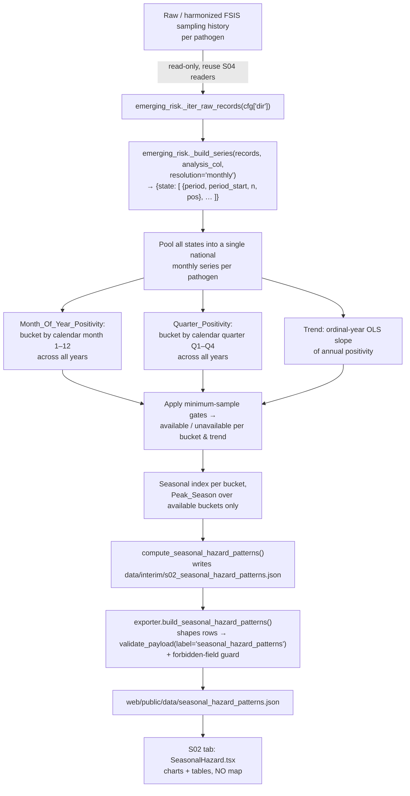

# Design Document

## Overview

S02 — Seasonal / Temporal Hazard Patterns is an additive analytical module that adds **one new web tab** to the existing VulneraSafe AI platform. It answers a single operational question: in which parts of the calendar year is each FSIS-monitored pathogen's historical positivity most elevated, so that inspection and testing cadence can be planned seasonally.

S02 is **descriptive only**. It trains no model, produces no forecast, and makes no contamination claim. Every value it reports is **OBSERVED** FSIS surveillance positivity, aggregated into calendar-month and calendar-quarter buckets plus a long-run annual trend. Where a bucket lacks enough samples to compute an honest statistic, S02 records an explicit `availability_status = "unavailable"` with a reason and the actual count found, and computes no value.

The module reuses the dated-series machinery already built for S04 (`src/analysis/emerging_risk.py`) **read-only** — it introduces no new ingestion, no new data source, and does not touch any S01/S03–S07 cache, source file, or web file. It mirrors the identity/honesty conventions of its siblings (S05 `human_comparison.py`, S07 `county_community_impact.py`): a fixed `MODULE_ID`/`METHOD_VERSION`, a dedicated cache, a single source file, a TypedDict schema with a mirrored TS type, a parity test, and a forbidden-field guard in the exporter.

Three pathogen/commodity pairs, matching `program_product._PATHOGEN_CONFIG`:

| Pathogen | Commodity |
|---|---|
| Salmonella | raw_poultry |
| Listeria | rte |
| STEC | raw_beef |

Identity (Req 1.1, 1.2): `MODULE_ID = "S02"`, `METHOD_VERSION = "s02.v1"`, implemented in `src/analysis/seasonal_hazard_patterns.py`, caching to `data/interim/s02_seasonal_hazard_patterns.json`.

## Architecture

### Data Flow



Key decisions:

- **Read-only reuse, no new ingestion (Req 2.1, 2.2).** S02 imports `_iter_raw_records`, `_build_series`, `_parse_date`, `_period_label`, `_period_start`, and `_PATHOGEN_CONFIG` from `src.analysis.emerging_risk`, and `wilson_ci` from `src.analysis.program_product`. It calls them but never mutates their inputs or outputs. This exactly mirrors how S05 (`fsis_state_year`) and S07 (`state_hazard`) reuse the same series without mutation.
- **Monthly native series, then pool.** `_build_series(..., resolution="monthly")` yields a per-state monthly series of `{period: "YYYY-MM", period_start, n, pos}` cells. S02 pools those cells **across all states and all years** into one national series per pathogen. Seasonality is a national calendar-time question here (geography is already S04/S06/S07's lens), so pooling to the national level is the honest grain and maximizes per-bucket sample counts.
- **Additive isolation (Req 1.3).** The only file S02 writes under `data/` is its own cache; the only files it adds are `src/analysis/seasonal_hazard_patterns.py`, the new schema TypedDict, the new TS interface, the new exporter builder, the new web panel, the new tests, and the App.tsx tab registration. No existing module file is edited except `exporter.py`, `schemas.py`, `artifacts.ts`, and `App.tsx`, each by **addition only**.

## Components and Interfaces

S02 is three cooperating units plus one new web panel. Each exposes a narrow, testable interface.

### `src/analysis/seasonal_hazard_patterns.py` (new)

Reused read-only from siblings:
- `from src.analysis.emerging_risk import _iter_raw_records, _build_series, _parse_date, _period_label, _period_start, _PATHOGEN_CONFIG`
- `from src.analysis.program_product import wilson_ci`

Module API:
- `MODULE_ID = "S02"`, `METHOD_VERSION = "s02.v1"`, `CACHE_PATH = data/interim/s02_seasonal_hazard_patterns.json` (mirrors S04/S05/S07 constants).
- `MIN_BUCKET_SAMPLES_MONTH = 30`, `MIN_BUCKET_SAMPLES_QUARTER = 30`, `MIN_YEARS_FOR_TREND = 3`.
- `_pool_monthly_series(series) -> list[cell]` — flatten `{state: [cells]}` from `_build_series(..., "monthly")` into one national list of `(year, month, n, pos)`.
- `_bucket_rate(cells, key_fn) -> {label: {n, pos}}` — group by month or quarter.
- `_trend_slope(annual_rates) -> Optional[float]` — closed-form ordinal-year OLS slope.
- `compute_seasonal_hazard_patterns(*, round_to=6) -> dict` — orchestrates all three pathogens and writes the cache (the one offline entry point, run under `__main__` like the siblings).
- `load_cache() -> Optional[dict]` — tolerant read (`(OSError, ValueError) -> None`), identical to the sibling `load_cache`.

### `src/artifacts/schemas.py` (add `SeasonalHazardRecord`)

A new TypedDict appended alongside the existing records; no existing TypedDict is edited. See [Data Models](#data-models).

### `src/artifacts/exporter.py` (add `build_seasonal_hazard_patterns`)

A new builder registered in `build_all_artifacts()`; details in [Exporter Integration](#exporter-integration).

### `web/src/components/panels/SeasonalHazard.tsx` (new) + `web/src/types/artifacts.ts` (add interface) + `web/src/App.tsx` (add tab)

See [Web Tab](#web-tab). The TS interface mirrors the Python TypedDict field-for-field.

## Decomposition Method

All statistics are computed from the pooled national monthly series per pathogen. Let the pooled series be a set of monthly cells each carrying `(year, month, n, pos)`.

### (a) Monthly positivity series

Reuse `_build_series(records, analysis_col, resolution="monthly")` per pathogen (same `analysis_col` values S04 uses). Collapse the `{state: [cells]}` map into a flat list of monthly cells, then group by `(year, month)` summing `n` and `pos`. Each `(year, month)` carries an OBSERVED sample count and positive count — no rate is invented for a month that was never sampled.

### (b) Month_Of_Year_Positivity — pooled rate (Req 3.1, 3.3)

For each calendar month `m ∈ 1..12`, pool across all years:

```
bucket_n[m]   = Σ_years n(year, m)
bucket_pos[m] = Σ_years pos(year, m)
rate[m]       = bucket_pos[m] / bucket_n[m]        # pooled positivity
(ci_low, ci_high) = wilson_ci(bucket_pos[m], bucket_n[m])
```

**Pooling vs mean-of-ratios — why pooling is the honest choice.** With thin monthly denominators, a mean-of-yearly-ratios weights a 3-sample year equally with a 3,000-sample year and is dominated by noise from thin years. A **pooled rate** (total positives / total samples) weights each observation once and is the maximum-likelihood positivity estimate for the bucket; its uncertainty is captured directly by the Wilson interval on the pooled counts. This matches how every sibling module reports positivity (S01/S03/S04/S05 all pool `pos/n` and attach `wilson_ci`). Pooling is recorded in the cache as `aggregation = "pooled_positivity"` so the choice is auditable.

### (c) Quarter_Positivity — pooled rate (Req 3.1, 3.3)

Identical construction over quarters `q ∈ {Q1,Q2,Q3,Q4}`, where a month `m` maps to quarter `(m-1)//3 + 1` (the same mapping `_period_start`/`_season_key` already use). Pooled rate + Wilson interval per quarter.

### (d) Trend — ordinal-year OLS slope (primary; Req 3.2)

**Chosen method: ordinal-year OLS slope of annual positivity.** For each distinct year, compute the pooled annual positivity `rate(year) = Σ_months pos / Σ_months n`. Fit a simple ordinary-least-squares line of `rate(year)` on the ordinal year index `0,1,2,…`. Report `slope` (change in positivity per year), its sign, and the list of `years_used`.

Rationale for choosing OLS slope over a classical additive seasonal-trend decomposition (e.g. STL / moving-average detrending):

- **Transparency.** A single slope with a sign is directly readable by the Operations Director ("positivity is rising/falling ~X per year") and is trivially reproducible and testable.
- **Robustness to thin months.** STL-style decomposition needs a regular, gap-free monthly series with enough cycles; FSIS monthly denominators are irregular and often thin (the very reason S04 locked `RESOLUTION = "quarterly"`). An additive decomposition on a ragged series would fabricate structure. Aggregating to **annual** positivity before fitting the slope sidesteps month-level raggedness while staying honest.
- **No modeling (Req 5.3).** OLS on observed annual rates is descriptive summary arithmetic, not a trained predictor. The slope is never extrapolated into a future period and is never labeled a forecast.

The seasonal component of the decomposition (Req 3.2) is represented by the **seasonal index** below; the trend component is this annual slope; the residual is implicit (observed minus pooled-bucket expectation) and is not re-reported as a separate fabricated series.

### (e) Seasonal index per bucket (Req 3.1)

For each available bucket, `seasonal_index = bucket_rate / overall_rate`, where `overall_rate = Σ_all pos / Σ_all n` for the pathogen. An index > 1 means that month/quarter runs hotter than the pathogen's overall average; < 1 cooler. This makes "when is it worst" directly readable and is computed only for buckets that pass their gate (an unavailable bucket has no index).

### (f) Peak_Season — argmax over available buckets only (Req 3.4)

`peak_month` = the month bucket with the highest `rate` **among buckets whose `availability_status == "available"`**; `peak_quarter` likewise over available quarter buckets. If no bucket in a view is available, the corresponding peak is `null` with a reason. The peak is never chosen from a gated-out bucket, so a 2-sample month can never win.

## Minimum-Sample Gating (exact, testable thresholds)

Gates are module constants, documented and recorded in the cache (Req 4.1). They are chosen consistent with S04's `MIN_SUPPORT = 30`:

| Constant | Value | Applies to |
|---|---|---|
| `MIN_BUCKET_SAMPLES_MONTH` | `30` | each calendar-month bucket's pooled `n` |
| `MIN_BUCKET_SAMPLES_QUARTER` | `30` | each calendar-quarter bucket's pooled `n` |
| `MIN_YEARS_FOR_TREND` | `3` | number of distinct years with any sampled month |

Gating rules:

- **Bucket passes (Req 4.2):** `bucket_n >= MIN_BUCKET_SAMPLES_*` → `availability_status = "available"`, report `rate`, `ci_low`, `ci_high`, `seasonal_index`.
- **Bucket fails (Req 4.3):** `bucket_n < MIN_BUCKET_SAMPLES_*` → `availability_status = "unavailable"`, `unavailable_reason` names the gate and the count, e.g. `"Only 12 samples; month bucket requires >= 30."`, `rate`/`ci`/`seasonal_index` stay `null`. The actual `n` (and `pos`) are still recorded.
- **Trend fails (Req 4.4):** fewer than `MIN_YEARS_FOR_TREND` distinct years → trend `availability_status = "unavailable"`, `unavailable_reason = "Only N distinct years; trend requires >= 3."`, `slope` stays `null`, `years_used` records the years found.
- **No fabrication (Req 4.5, 5.1):** an unavailable statistic is never filled by interpolation, estimation, carry-forward, or placeholder.

Because monthly denominators are thinner than quarterly ones, **the quarter view is the robust default and the month view is best-effort/gated** — many months will legitimately render as unavailable, and that is an honest, expected outcome the UI makes explicit rather than hiding. A pathogen whose entire series fails to build (Req 2.4) produces a single pathogen-level `availability_status = "unavailable"` block with the missing-input reason, and the module continues with the other pathogens.

## Cache Schema

`data/interim/s02_seasonal_hazard_patterns.json`, written with `json.dumps(..., indent=2, sort_keys=True)` for determinism (mirrors S04/S07):

```json
{
  "module_id": "S02",
  "method_version": "s02.v1",
  "generated_at": "<deterministic stamp>",
  "resolution": "monthly",
  "aggregation": "pooled_positivity",
  "ci_method": "wilson_95",
  "trend_method": "ordinal_year_ols_slope",
  "min_bucket_samples_month": 30,
  "min_bucket_samples_quarter": 30,
  "min_years_for_trend": 3,
  "pathogens": {
    "Salmonella": {
      "pathogen": "Salmonella",
      "commodity": "raw_poultry",
      "availability_status": "available",
      "unavailable_reason": null,
      "fsis_input_id": "raw_poultry_salmonella",
      "periods_read": ["2015-01", "2015-02", "..."],
      "overall_rate": 0.0123,
      "month_buckets": [
        {
          "label": "01", "n": 1234, "pos": 15,
          "rate": 0.012155, "ci_low": 0.0074, "ci_high": 0.0199,
          "seasonal_index": 0.99, "availability_status": "available",
          "unavailable_reason": null
        }
      ],
      "quarter_buckets": [
        {
          "label": "Q1", "n": 3456, "pos": 40,
          "rate": 0.011574, "ci_low": 0.0085, "ci_high": 0.0157,
          "seasonal_index": 0.94, "availability_status": "available",
          "unavailable_reason": null
        }
      ],
      "trend": {
        "method": "ordinal_year_ols_slope",
        "slope": -0.00042,
        "years_used": [2015, 2016, 2017, 2018],
        "availability_status": "available",
        "unavailable_reason": null
      },
      "peak_month": "08",
      "peak_quarter": "Q3"
    }
  }
}
```

Notes:
- `periods_read` satisfies Req 2.3 / 8.2 (auditable inputs per pathogen). `fsis_input_id` records the identifier of the FSIS input used.
- `month_buckets` always lists all 12 months and `quarter_buckets` all 4 quarters, each with its availability status — an absent/gated month is present-but-unavailable, never dropped.
- `peak_month` / `peak_quarter` are `null` when no bucket in that view is available.
- Determinism (Req 8.1, 8.3): all aggregation is integer-summing + deterministic division + a closed-form OLS slope; `sort_keys=True` + fixed float rounding make repeated runs byte-identical.

## Data Models

### Cache (internal) — see [Cache Schema](#cache-schema) above

The on-disk `s02_seasonal_hazard_patterns.json` is the module's internal data model: per-pathogen blocks each holding `month_buckets` (12), `quarter_buckets` (4), a `trend` block, and `peak_month`/`peak_quarter`.

### Artifact TypedDict + TS Type

One record per `(pathogen, view, bucket)` keeps the artifact flat and the parity test unambiguous, following the S01 `ProgramProductStratum` "one stratum per row" shape and the S07 availability pattern. The trend and peaks are repeated on each of a pathogen's rows (same technique S07 uses for `weight_sensitivity`), so the web tab reads them without a second artifact.

`SeasonalHazardRecord` in `src/artifacts/schemas.py` (and its field-for-field mirror `SeasonalHazardRecord` in `web/src/types/artifacts.ts`). Exact field list (every value-bearing field OBSERVED-tagged; `availability_status`/`unavailable_reason` carried per Req 6.4):

| Field | Python type | Notes |
|---|---|---|
| `artifact_version` | `str` | |
| `module_id` | `str` | "S02" |
| `method_version` | `str` | "s02.v1" |
| `pathogen` | `str` | |
| `commodity` | `str` | |
| `view` | `str` | "month" \| "quarter" |
| `bucket_label` | `str` | "01".."12" or "Q1".."Q4" |
| `sample_n` | `Optional[int]` | |
| `positive_n` | `Optional[int]` | |
| `rate` | `Optional[float]` | pooled positivity; null when unavailable |
| `ci_low` | `Optional[float]` | Wilson 95% |
| `ci_high` | `Optional[float]` | Wilson 95% |
| `ci_method` | `str` | "wilson_95" |
| `seasonal_index` | `Optional[float]` | bucket rate / overall rate |
| `overall_rate` | `Optional[float]` | pathogen pooled overall |
| `is_peak` | `bool` | True when this bucket is the view's Peak_Season |
| `trend_method` | `str` | "ordinal_year_ols_slope" |
| `trend_slope` | `Optional[float]` | per-year change; null when trend unavailable |
| `trend_years_used` | `list[int]` | distinct years used |
| `trend_availability_status` | `str` | "available" \| "unavailable" |
| `trend_unavailable_reason` | `Optional[str]` | |
| `pattern_label` | `str` | constant "historical seasonal pattern" (Req 5.4) |
| `status` | `StatusTag` | always "OBSERVED" |
| `availability_status` | `str` | "available" \| "unavailable" |
| `unavailable_reason` | `Optional[str]` | names the gate + count when unavailable |
| `periods_read_count` | `int` | count of months read for the pathogen (audit) |
| `generated_at` | `str` | |

That is **27 fields.** The TS `SeasonalHazardRecord` interface mirrors them with identical `snake_case` names and `number | null` / `string | null` / `boolean` / `number[]` types, reusing the shared `StatusTag` union.

**Forbidden-field guard (Req 6.3):** no field name contains a banned fabrication token (`forecast`, `predicted`, `prediction`, `contaminat`, `infection`, `illness_estimate`, `future`). The chosen names deliberately avoid these — `pattern_label`, `seasonal_index`, `trend_slope`, `is_peak` carry no banned substring — so the guard passes.

## Exporter Integration

Add `build_seasonal_hazard_patterns()` to `src/artifacts/exporter.py`, mirroring `build_county_community_impact()`:

1. `from src.analysis.seasonal_hazard_patterns import load_cache, METHOD_VERSION` and read the cache. If absent, emit one `availability_status="unavailable"` sentinel row per pathogen (`view="quarter"`, `bucket_label="(all)"`) with a run-the-build reason — never raise, mirroring the S07 cache-missing path.
2. For each pathogen, for each month bucket and quarter bucket, shape a `SeasonalHazardRecord` with `_round(...)` applied to every float, `status="OBSERVED"`, `pattern_label="historical seasonal pattern"`, and the pathogen's trend/peak fields repeated. `is_peak = (bucket_label == peak_month)` for month rows and `(bucket_label == peak_quarter)` for quarter rows.
3. Sort deterministically by `(pathogen, view, bucket_label)`.
4. Run the forbidden-field guard over row keys (the `_banned` token-scan pattern already used by `build_county_community_impact`, extended with the S02 tokens above) — raise `SchemaValidationError` and write nothing on a hit.
5. In `build_all_artifacts()`, call it and `validate_payload(seasonal_hazard_patterns, SeasonalHazardRecord, label="seasonal_hazard_patterns")`, then add `"seasonal_hazard_patterns": seasonal_hazard_patterns` to the returned payload dict. `_build_artifact_objects` then writes `seasonal_hazard_patterns.json` and the manifest records its checksum + record_count automatically.

**File count.** The exporter currently writes 28 files (manifest + the artifacts enumerated in `build_all_artifacts`, including the CSV companions for the 5 `_CSV_ARTIFACTS`). S02 adds exactly **one** new JSON artifact (`seasonal_hazard_patterns.json`) and is **not** in `_CSV_ARTIFACTS`, so the exporter's written-file count goes from **28 to 29**. The exporter test that asserts the count must be bumped by one accordingly.

## Web Tab

New panel `web/src/components/panels/SeasonalHazard.tsx` — **charts and tables only, no map**, so no maplibre dependency (unlike CountyCommunities, which reuses the map-fallback grid). Navy/teal aesthetic via the same Tailwind tokens (`bg-navy`, `text-teal`, `PanelShell`, `StatusTag`, `EmptyState`, `ArtifactBody`).

Layout, per selected pathogen:
- **Pathogen selector** — three buttons Salmonella / Listeria / STEC (`data-testid="pathogen-selector"`), identical pattern to CountyCommunities' selector (Req 7.4).
- **Month-of-year chart** (`data-testid="month-chart"`) — 12 bars/points of positivity with Wilson CI whiskers; available months render the value + CI, gated months render a dashed "not available" marker carrying the reason (Req 7.3).
- **Quarter chart** (`data-testid="quarter-chart"`) — Q1–Q4 positivity with CI; same unavailable treatment.
- **Trend readout** (`data-testid="trend-readout"`) — plain-language sign + magnitude ("positivity trending down ~0.04%/yr over 2015–2018"), or an explicit unavailable note with the reason when the trend is gated.
- **Peak Season callout** (`data-testid="peak-season"`) — labeled **"historical seasonal pattern"**; the copy never uses "forecast", "prediction", or "risk forecast" (Req 5.4). Shows peak month and peak quarter, or "not available" when no bucket qualifies.
- **Unavailable indicator** (`data-testid="unavailable-note"`) — reusable element that renders a bucket/trend's `unavailable_reason` in place of a value (Req 7.3), never a blank or fabricated number.
- Panel root `data-testid="seasonal-hazard"`.
- Artifact load failure → `ArtifactBody`'s error state identifies `seasonal_hazard_patterns` and renders no fabricated content (Req 7.5).

Charts are implemented as lightweight inline SVG/flex bars (same approach as the `Bar` component in CountyCommunities) rather than a heavy chart lib, keeping the component testable under jsdom with no WebGL/canvas dependency.

**App wiring (Req 7.1).** Add to `web/src/App.tsx`, additively:
- Extend the `Tab` union with `"seasonal"`.
- Add `{ id: "seasonal", label: "Seasonal Patterns" }` to the `tabs` array.
- Import `SeasonalHazard` and add a `tab === "seasonal" ? <SeasonalHazard /> : …` branch in `AppBody`.
All existing tabs, panels, and their tests are untouched.

## Correctness Properties

*A property is a characteristic or behavior that should hold true across all valid executions of a system — essentially, a formal statement about what the system should do. Properties serve as the bridge between human-readable specifications and machine-verifiable correctness guarantees.*

S02's core is pure aggregation, gating, peak-selection, and slope arithmetic over generated monthly cells — a natural fit for property-based testing. The properties below are the deduplicated set from the prework analysis; each is implemented by a single property-based test (minimum 100 iterations), tagged `Feature: s02-seasonal-hazard-patterns, Property N: <text>`. UI copy, schema-rejection, and parity concerns are intentionally covered by example/unit tests in the Testing Strategy, not restated as properties.

### Property 1: Read-only, no input mutation

*For any* generated FSIS record list, running `compute_seasonal_hazard_patterns` leaves that record list structurally equal to a deep copy taken before the run.

**Validates: Requirements 1.4, 2.1**

### Property 2: periods_read is exactly the months present

*For any* generated set of monthly cells, a pathogen's `periods_read` in the cache equals exactly the set of distinct `YYYY-MM` labels present in that pathogen's input.

**Validates: Requirements 2.3**

### Property 3: Pooled bucket rate and recorded counts

*For any* generated monthly cells, each month bucket's recorded `n`/`pos` equal the summed `n`/`pos` over that calendar month across all years and, when available, its `rate` equals `Σpos / Σn`; each quarter bucket's `n`/`pos`/`rate` equal the pooled sums/rate over its three constituent months — for every bucket regardless of availability (counts are always recorded).

**Validates: Requirements 3.1, 3.3**

### Property 4: Peak_Season is the argmax over available buckets only

*For any* generated monthly cells, `peak_month` (resp. `peak_quarter`) is the bucket with the highest `rate` among buckets whose `availability_status == "available"`, is never an unavailable bucket even when a gated bucket has a higher raw rate, and is `null` when no bucket in that view is available.

**Validates: Requirements 3.4**

### Property 5: Trend slope sign and year gate

*For any* generated annual positivity series with at least `MIN_YEARS_FOR_TREND` distinct years, a strictly increasing series yields `trend_slope > 0`, a strictly decreasing series yields `trend_slope < 0`, and a constant series yields `trend_slope == 0`; *for any* series with fewer than `MIN_YEARS_FOR_TREND` distinct years, the trend is `unavailable` with `trend_slope` null and `years_used` recording the years found.

**Validates: Requirements 3.2, 4.4**

### Property 6: Gate availability in both directions

*For any* generated bucket, a pooled `n >= MIN_BUCKET_SAMPLES_*` yields `availability_status == "available"` with a non-null `rate`, and a pooled `n < MIN_BUCKET_SAMPLES_*` yields `availability_status == "unavailable"` with a non-empty `unavailable_reason` naming the gate and the recorded `n` equal to the actual count.

**Validates: Requirements 4.2, 4.3**

### Property 7: No fabricated fills for unavailable statistics

*For any* generated monthly cells, every bucket or trend in the cache whose `availability_status == "unavailable"` has null `rate`/`ci_low`/`ci_high`/`seasonal_index` (or null `trend_slope`) — no interpolated, estimated, carried-forward, or placeholder value appears anywhere.

**Validates: Requirements 4.5, 6.4**

### Property 8: Every record is OBSERVED

*For any* generated monthly cells, every emitted `SeasonalHazardRecord` carries `status == "OBSERVED"`; no PREDICTED, SIMULATED, or placeholder status is ever produced.

**Validates: Requirements 5.1, 6.4**

### Property 9: Deterministic, reproducible cache

*For any* generated monthly cells, two independent runs of `compute_seasonal_hazard_patterns` over identical inputs produce byte-identical cache JSON (`json.dumps(..., sort_keys=True)` with fixed float rounding).

**Validates: Requirements 8.1, 8.3**

## Error Handling

Every failure path resolves to an explicit, honest state — never a crash into fabricated output.

- **Missing / unreadable FSIS input for a pathogen (Req 2.4).** `_build_series` returns an empty series; S02 emits that pathogen's block with `availability_status = "unavailable"` and an `unavailable_reason` naming the missing input, and continues with the remaining pathogens.
- **Thin bucket below its gate (Req 4.3).** Not an error — a defined outcome: `availability_status = "unavailable"`, reason naming the gate and count, no value computed.
- **Trend below the year gate (Req 4.4).** `trend.availability_status = "unavailable"` with the year count; `slope` stays null.
- **Detected mutation of a shared FSIS input (Req 1.5).** S02 reads inputs into local structures and never writes back; if a post-read integrity check finds a shared input changed, the module halts and records an error indication identifying the mutated input rather than continuing.
- **Division by zero.** `rate` is computed only when `bucket_n > 0`; `wilson_ci` already returns `(None, None)` when `n == 0`; `seasonal_index` is skipped when `overall_rate` is 0.
- **Missing cache at export time.** `build_seasonal_hazard_patterns()` emits per-pathogen unavailable sentinel rows with a run-the-build reason instead of raising (mirrors the S07 cache-missing path).
- **Schema / forbidden-field violation.** `validate_payload` raises `SchemaValidationError` identifying the offending field, and the forbidden-field guard raises before any byte is written (Req 6.2, 6.3).
- **Artifact missing / invalid at load in the web tab (Req 7.5).** `ArtifactBody` renders an error state identifying `seasonal_hazard_patterns` and no fabricated seasonal content.

## Testing Strategy

The project verifies via an external command runner (full `pytest` ≈ 16 min, plus `npm`/`tsc`/`vite build`). The S02 design is built so every unit can be tested in isolation: the analysis functions are pure given an injected record list, the exporter builder reads a cache the test can write to a temp path, and the web component reads a fixture artifact.

**Property-based testing applies here** — the aggregation, gating, peak-selection, and trend arithmetic are pure functions with universal properties over generated inputs (counts, years). A property-based library for Python (Hypothesis — already in use in this repo, per the `.hypothesis` cache) implements each of the nine Correctness Properties above as a **single** test at minimum 100 iterations, tagged `Feature: s02-seasonal-hazard-patterns, Property N: <text>`. We do not hand-roll input generation.

Python property tests in `tests/test_seasonal_hazard_patterns.py` (one per property):
- **P1 read-only no-mutation** (Req 1.4, 2.1) — injected record list unchanged after a build.
- **P2 periods_read exactness** (Req 2.3).
- **P3 pooled rate + recorded counts** (Req 3.1, 3.3) — bucket `rate == Σpos/Σn`, not a mean of per-year ratios; `n`/`pos` recorded even when unavailable.
- **P4 peak over available only** (Req 3.4) — a higher-rate but gated bucket never wins; null when none available.
- **P5 trend slope sign + year gate** (Req 3.2, 4.4).
- **P6 gate availability both directions** (Req 4.2, 4.3) — unavailable carries reason + actual count.
- **P7 no fabricated fills** (Req 4.5, 6.4).
- **P8 every record OBSERVED** (Req 5.1, 6.4).
- **P9 determinism** (Req 8.1, 8.3) — two runs → byte-identical cache JSON.

Python example/unit tests (same file) for the non-property criteria:
- **Guardrail copy** (Req 5.2) — `pattern_label == "historical seasonal pattern"`.
- **Forbidden-field guard** (Req 6.3) — injecting a banned field-name token raises `SchemaValidationError` and writes nothing.

Exporter test (in `tests/test_exporter.py` or a dedicated test):
- `build_seasonal_hazard_patterns()` output passes `validate_payload(..., SeasonalHazardRecord)`.
- Forbidden-field guard: injecting a row key containing a banned token raises `SchemaValidationError` and writes nothing (Req 6.2, 6.3).
- Written-file count is 29 (bumped from 28).

Parity test (append to `tests/test_seasonal_hazard_patterns.py`, mirroring `test_p13_county_community_impact_python_ts_parity`):
- `set(typing.get_type_hints(SeasonalHazardRecord)) == _ts_interface_fields(artifacts.ts, "SeasonalHazardRecord")`, with `len == 27` (Req 6.5).

Web component test `web/src/components/panels/__tests__/SeasonalHazard.test.tsx`:
- Renders available buckets with their rate/CI.
- Renders the `unavailable-note` with the reason for a gated bucket (Req 7.3).
- Pathogen selector switches the displayed statistics (Req 7.4).
- Peak-season callout text reads "historical seasonal pattern" and contains neither "forecast" nor "prediction" (Req 5.4).

## Honesty / Guardrails Recap

- **Descriptive only; no model (Req 5.3)** → OLS annual-slope + pooled bucket rates are summary arithmetic, never a trained predictor; the slope is never extrapolated.
- **OBSERVED only (Req 3.5, 5.1, 6.4)** → every record is `status="OBSERVED"`; there is no PREDICTED/SIMULATED/placeholder path.
- **Never implies contamination or a forecast (Req 5.2, 5.4)** → `pattern_label = "historical seasonal pattern"`; the forbidden-field guard bans forecast/prediction/contamination tokens in field names; the Peak Season UI copy is constrained to historical language.
- **Pooled rates + CIs (Req 3.1, 3.3)** → pooled positivity with `wilson_ci`, documented as `aggregation = "pooled_positivity"`.
- **Explicit gating (Req 4.1–4.5)** → `MIN_BUCKET_SAMPLES_MONTH=30`, `MIN_BUCKET_SAMPLES_QUARTER=30`, `MIN_YEARS_FOR_TREND=3`; unavailable statistics carry a reason + the actual count and no value.
- **Reproducible / deterministic (Req 8.1–8.3)** → integer sums + closed-form arithmetic, `sort_keys=True`, fixed float rounding, `periods_read` recorded.
- **Additive isolation (Req 1.3, 2.2, 7.1)** → one new source file, one new cache, one new artifact, one new tab; existing modules and tabs untouched; FSIS reused read-only via the S04 helpers.

### Requirement → design element map

| Requirement | Design element |
|---|---|
| 1.1, 1.2 | `MODULE_ID="S02"`, `METHOD_VERSION="s02.v1"`, `src/analysis/seasonal_hazard_patterns.py`, `data/interim/s02_seasonal_hazard_patterns.json` |
| 1.3, 1.4 | Additive isolation; read-only reuse of S04 helpers |
| 1.5 | Pathogen-level unavailable block on a detected shared-input mutation |
| 2.1, 2.2, 2.3 | Reuse `_iter_raw_records`/`_build_series`; `fsis_input_id` + `periods_read` in cache |
| 2.4 | Per-pathogen unavailable + continue when an input is absent |
| 3.1, 3.3 | Month/Quarter pooled positivity + counts + Wilson CI + seasonal index |
| 3.2 | Ordinal-year OLS trend slope (seasonal index = seasonal component) |
| 3.4 | Peak_Season argmax over available buckets only |
| 3.5, 5.1 | `status="OBSERVED"`, `pattern_label` on every record |
| 4.1–4.5 | Gating constants, availability tags, reason+count, no fabrication |
| 5.2, 5.3, 5.4 | No model; no contamination/forecast implication; historical-pattern labeling |
| 6.1–6.5 | `SeasonalHazardRecord` TypedDict + TS mirror; exporter validate + forbidden-field guard; OBSERVED tagging; parity test |
| 7.1–7.5 | `SeasonalHazard.tsx` tab, selector, charts, unavailable note, error state; App wiring |
| 8.1–8.3 | Deterministic cache, recorded inputs, reproducible arithmetic |
