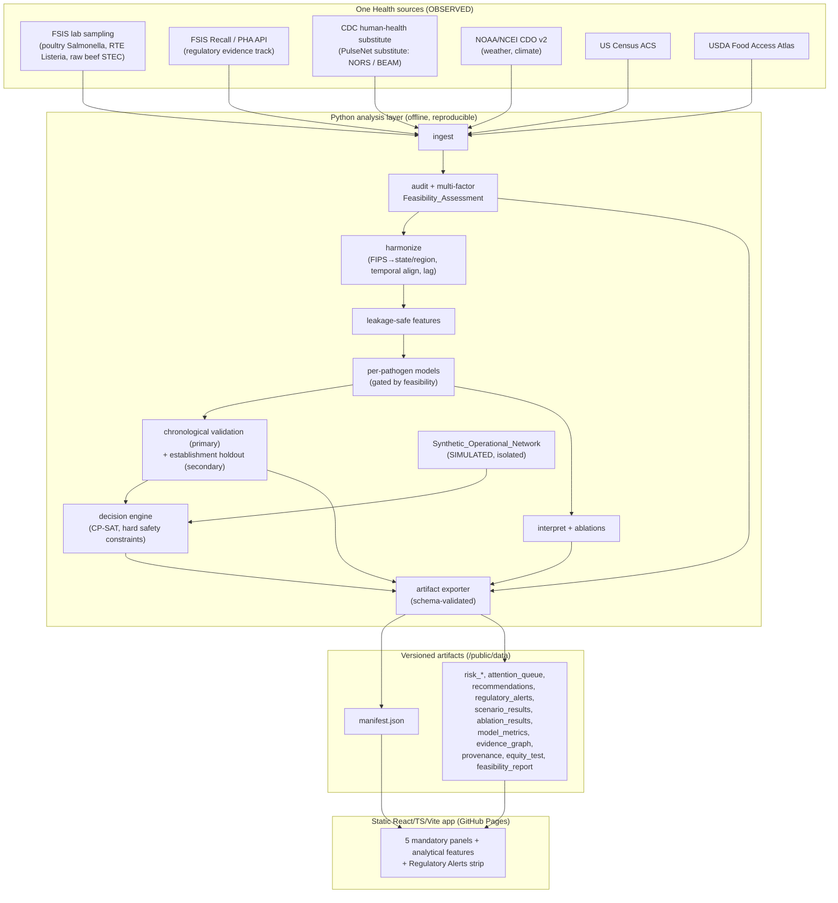
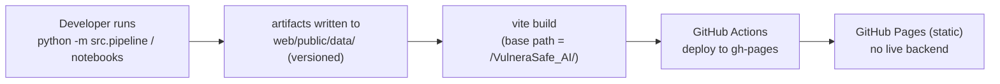
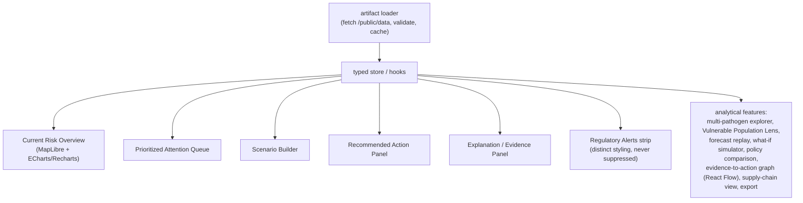
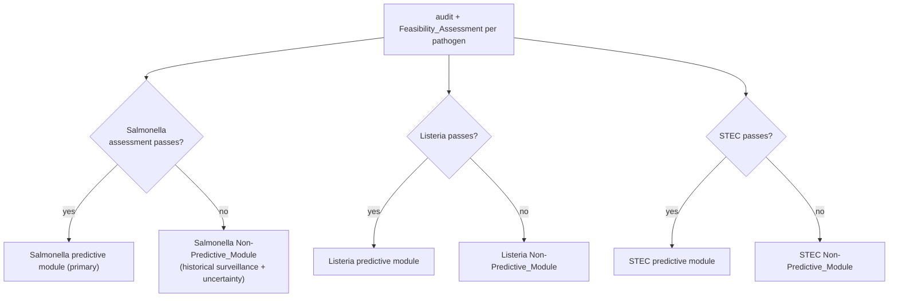
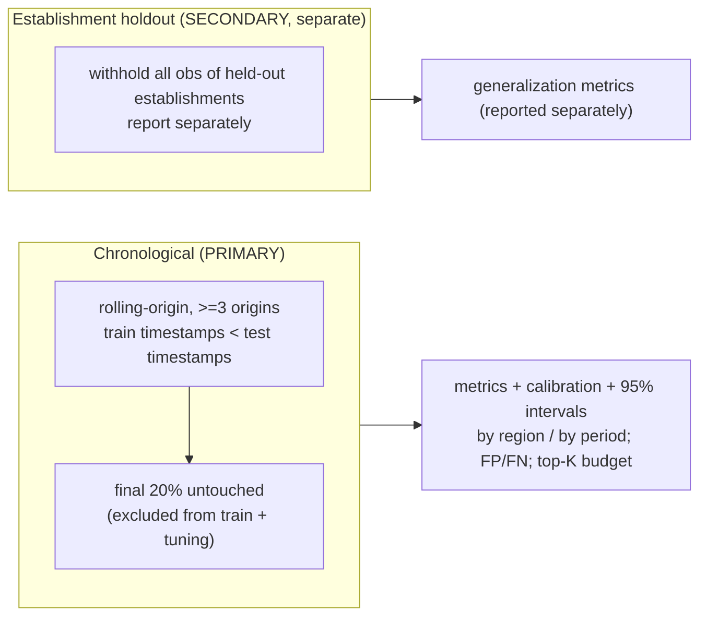
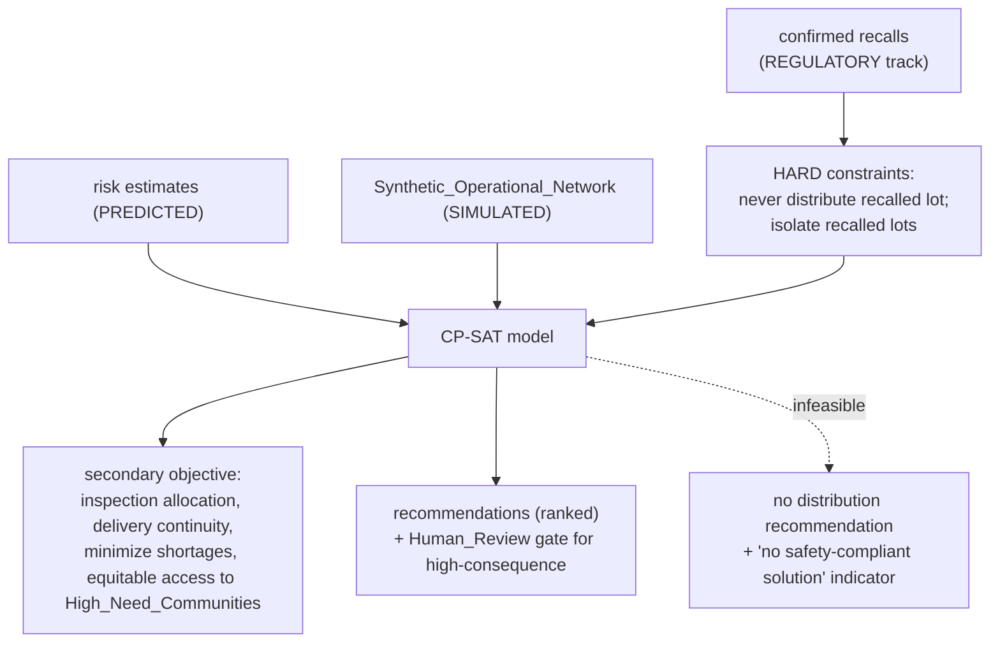
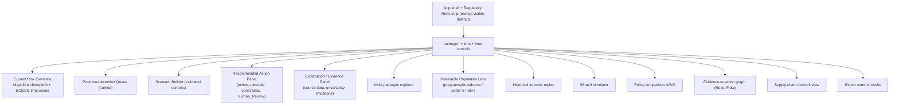

# Design Document

## Overview

VulneraSafe AI is a multi-pathogen, vulnerability-aware, One Health food-safety early-warning and operational decision-support platform. The design here is deliberately shaped by two hard facts: it must ship inside a 48-hour hackathon, and it must run on GitHub Pages with no paid backend. Both point to the same architecture — a **static, precomputed-artifact system**.

A Python analysis layer runs the full scientific pipeline offline (ingestion → audit/feasibility → harmonization → modeling → optimization → artifact export) and emits **versioned JSON/CSV/Parquet artifacts**. A static React/TypeScript/Vite app consumes those artifacts from `/public/data` at load time and issues no runtime API calls. This cleanly separates the two work streams: Python produces data that satisfies a published schema contract; the web app renders whatever matches that contract. The contract (Section 7) is the single coordination point, so both streams can proceed in parallel after it is fixed.

The design incorporates five scientific corrections already settled in the requirements:

1. **Feasibility is multi-factor.** A pathogen is predictive-capable only if a `Feasibility_Assessment` jointly clears train/test positive counts, temporal coverage, geographic coverage, achievable calibration, and prediction stability — not a single ≥30-positive threshold.
2. **Temporal resolution is per-pathogen.** Monthly vs quarterly is chosen from each pathogen's actual sample availability, not globally.
3. **Chronological validation is primary.** `Establishment_Holdout_Validation` is a separate, secondary generalization check reported independently.
4. **Regulatory evidence is independent of model uncertainty.** Verified official recalls/public-health alerts are shown on their own track, never suppressed when model uncertainty is missing, and visually distinguished from model-generated alerts.
5. **Team science documents only real contributions.** Uncovered disciplines are flagged as gaps, never filled with fabricated specialists.

The modeling spine everywhere is the `Modeling_Unit` = **pathogen × commodity × region × time**, with region = US state / FSIS region and temporal resolution chosen per pathogen.

## Architecture

### High-level component flow

The system is two layers joined by an artifact contract. The Python layer is a DAG of stages; the web layer is a set of panels that each bind to one or more artifacts.



The FSIS **recall/PHA track is drawn separately** from the modeling spine on purpose: recalls are regulatory facts that flow straight to the `regulatory_alerts` artifact and the decision engine's hard constraints, bypassing the probabilistic model entirely. This is the structural expression of correction (4).

### Deployment architecture



Reproducibility is enforced at the boundary: the exporter stamps `manifest.json` with `artifact_version` and `generated_at`, pins library versions, and runs from fixed seeds so identical inputs produce identical artifacts (Req 15.5).

## Repository Structure

```
VulneraSafe_AI/
  NAFSI Data Challenge.docx.pdf      # challenge brief (authoritative), lives at repo root
  requirements.txt                   # pinned versions
  README.md                          # reproducibility + build/deploy instructions
  .kiro/                             # specs, steering, prompts, hooks (Kiro deliverable)
  data/
    raw/                             # ISOLATED, read-only; downloaded sources + checksums
    interim/                         # partially processed
    processed/                       # harmonized analytic tables (Parquet/CSV)
    synthetic/                       # ISOLATED; Synthetic_Operational_Network, labeled SIMULATED
  src/
    pipeline/
      ingest.py                      # per-source fetchers, provenance records, checksums
      audit.py                       # counts, positivity w/ program denominator, delay, leakage
      feasibility.py                 # multi-factor Feasibility_Assessment + decision logic
      harmonize.py                   # FIPS crosswalk, temporal alignment/lagging, join keys
      features.py                    # leakage-safe feature construction (cutoff-enforced)
    models/
      baseline.py                    # seasonal/historical + regularized logistic
      integrated.py                  # XGBoost/LightGBM + RandomForest, rare-event handling
      validation.py                  # chronological (primary) + establishment holdout (secondary)
      ablation.py                    # FSIS-only / +CDC / +NOAA / full; signed contributions
      interpret.py                   # permutation importance, SHAP, error analysis
    decision/
      synth_network.py               # seeded Synthetic_Operational_Network generator (SIMULATED)
      optimizer.py                   # OR-Tools CP-SAT, hard safety constraints
      scenarios.py                   # three scenarios
      policies.py                    # policies A / B / C
    artifacts/
      schemas.py                     # Python TypedDict contracts (mirror of TS interfaces)
      exporter.py                    # schema-validated artifact writer + manifest
  web/
    public/data/                     # precomputed artifacts consumed at runtime
    src/                             # React app (panels, components, data-loading layer)
    package.json
    vite.config.ts
  docs/
    data_dictionary.md
    provenance.md
    reports/                         # PDF report sources + figures
    team_science.md
  tests/
    test_audit.py  test_feasibility.py  test_leakage.py
    test_optimizer.py  test_schemas.py
    web/                             # vitest + testing-library + schema parity
```

Raw and synthetic data live in **physically separate directories** and never share a record set (Req 4.4). The challenge PDF stays at repo root as the authoritative scope reference.

## Components and Interfaces

### Python pipeline stages

Each stage is a pure-ish function over typed inputs, writing to `data/` and returning records the next stage consumes. Stage contracts:

| Stage | Input | Output | Enforces |
|-------|-------|--------|----------|
| `ingest` | source configs | raw files + `Provenance_Record[]` | Req 2.1–2.3, 4.1–4.3 (URL, ISO8601 date, checksum) |
| `audit` | raw tables | `AuditReport` per dataset | Req 3.1–3.4 (counts, positivity, delay, leakage) |
| `feasibility` | audit reports | `FeasibilityAssessment` per pathogen | Req 3.5–3.6 (multi-factor classification, per-pathogen resolution) |
| `harmonize` | raw + crosswalks | `processed/` analytic tables + data dictionary | Req 2.6–2.8 |
| `features` | analytic tables + cutoff | feature matrix | Req 7.4–7.6 (cutoff-safe only) |
| `models` | feature matrix | fitted models + predictions | Req 6, 7.1–7.3 |
| `validation` | models + predictions | `model_metrics` | Req 8 |
| `interpret`/`ablation` | models | SHAP, importances, `ablation_results` | Req 9 |
| `decision` | risk + synthetic network + recalls | `recommendations`, `scenario_results` | Req 10, 11 |
| `exporter` | all above | versioned artifacts + `manifest` | Req 15.5 |

### Per-source ingestion interfaces

Each fetcher records a `Provenance_Record` and halts its own stream on failure without aborting the others (Req 2.3, 3.7).

| Source | Endpoint / access | Access note |
|--------|-------------------|-------------|
| FSIS lab sampling (raw poultry Salmonella, RTE Listeria, raw beef STEC) | FSIS data downloads (CSV) | Bulk file download; record sampling program for correct `Program_Denominator`. |
| FSIS Recall / PHA | FSIS Recall API (JSON) | Regulatory-evidence track; feeds `regulatory_alerts` + hard constraints. |
| CDC human-health substitute | public CDC (NORS or BEAM dashboard export) | Flagged as PulseNet substitute with justification recorded in provenance (Req 2.2). |
| NOAA/NCEI CDO v2 | `www.ncei.noaa.gov/cdo-web/api/v2` | **Token required**; document token acquisition (free request form) and store token outside the repo (env var). |
| US Census ACS | Census ACS API | API key recommended; document acquisition. |
| USDA Food Access Research Atlas | bulk file download (xlsx/CSV) | No API; manual/bulk download with checksum. |

### Web component map

The data-loading layer (`web/src/data/`) fetches artifacts once, validates them against generated types, and exposes typed hooks (`useManifest()`, `useArtifact(name)`). Panels are pure consumers.



Shared UI primitives: a `StatusTag` component rendering exactly one of `OBSERVED | PREDICTED | SIMULATED`; an `AlertBadge` distinguishing `REGULATORY` from `MODEL`; an `EmptyState` component for missing-data and artifact-load-failure cases (Req 12.3, 15.3).

## Data Models

### Core analytic entities (Python side)

```python
# Modeling spine
ModelingUnit = TypedDict("ModelingUnit", {
    "pathogen": str,        # "Salmonella" | "Listeria" | "STEC"
    "commodity": str,       # e.g. "raw_poultry"
    "region": str,          # US state / FSIS region code
    "period": str,          # ISO period; resolution per pathogen
})
```

Harmonization keys: every source is mapped to `(region, period)`. County-level sources (ACS, Food Access Atlas) use a **FIPS county → state/FSIS-region crosswalk**; all sources are temporally aligned to the per-pathogen resolution with explicit lags applied to predictor sources so features never cross the horizon cutoff.

### Provenance and audit

```python
class ProvenanceRecord(TypedDict):
    source: str
    url: str
    access_date: str            # ISO 8601 YYYY-MM-DD
    license: str
    geographic_coverage: str
    temporal_coverage: str
    checksum: str               # over downloaded file
    total_samples: int
    positive_count: int
    missingness: dict[str, float]   # column -> 0.0..1.0
    known_biases: list[str]

class AuditReport(TypedDict):
    dataset: str
    observation_count: int
    positive_count: int
    negative_count: int
    positivity_rate: float          # positives / Program_Denominator
    program_denominator: int
    yearly_distribution: dict[str, int]
    quarterly_distribution: dict[str, int]
    establishment_ids: list[str]
    collection_date_range: tuple[str, str]
    publication_date: str
    reporting_delay_days: int
    leakage_checks: list[dict]      # {name, passed: bool, triggering_fields}
    complete: bool                  # false if any required field unavailable
```

### Multi-factor feasibility (correction 1)

The `Feasibility_Assessment` is the gate for every predictive module. It is a record of factor values plus a derived classification, not a single threshold.

```python
class FeasibilityFactor(TypedDict):
    name: str                       # train_positives | test_positives |
                                    # temporal_coverage | geographic_coverage |
                                    # calibration | stability
    value: float
    threshold: float
    passed: bool

class FeasibilityAssessment(TypedDict):
    pathogen: str
    temporal_resolution: str        # "monthly" | "quarterly" (correction 2)
    resolution_evidence: str        # availability basis for the choice
    factors: list[FeasibilityFactor]
    classification: str             # "predictive" | "non_predictive"
    rationale: str
```

**Decision logic.** A pathogen is classified `predictive` only when all required factors pass; otherwise `non_predictive`, and its module becomes a `Non-Predictive_Module` presenting historical surveillance with uncertainty (Req 6.2–6.4). Salmonella is attempted as the primary module; Listeria and STEC are attempted only if their assessment passes. The assessment and every factor value are exported to the web app (Req 6.5).

### Status tagging

Every value-bearing field carried into an artifact is tagged `OBSERVED`, `PREDICTED`, or `SIMULATED`. Surveillance/weather/demographics → OBSERVED; model outputs for future periods → PREDICTED; synthetic-network and what-if outputs → SIMULATED. Exactly one tag per displayed value (Req 14.3).
## ML Pipelines

### Prediction target and horizon (Req 5)

The target is a **binary indicator**: whether pathogen-positive sampling in the next `Prediction_Horizon` exceeds a documented baseline computed over a fixed lookback of ≥12 months (or a stated program-specific threshold) at the `Modeling_Unit`. The horizon is fixed to a single value **before any tuning** and never changed afterward. A count/rate formulation is evaluated alongside the binary one and the chosen formulation plus rationale recorded (Req 5.4). Modeling_Units with insufficient history are excluded with a recorded reason (Req 5.2). The target is explicitly surveillance risk at the unit, never a claim that a specific shipment is contaminated (Req 5.5).

### Per-pathogen modules gated by feasibility (Req 6)



Salmonella in raw poultry is the primary predictive target. Listeria (RTE) and STEC (raw beef) become predictive modules **only if** their multi-factor assessment passes; otherwise they render as `Non-Predictive_Module`s showing historical surveillance with uncertainty. Each module exposes its status and factor values to the web app.

### Models, features, rare events (Req 7)

- **Baselines:** a seasonal/historical baseline and a regularized logistic model, both recorded with configuration and metrics for comparison.
- **Integrated models:** a gradient-boosting model (XGBoost or LightGBM) and a RandomForest.
- **Rare events:** where positive-class prevalence < 10%, apply class-weighting / rare-event handling (e.g. `scale_pos_weight`, stratified resampling) and report under rare-event-appropriate metrics.
- **Features (leakage-safe):** lagged FSIS positivity and sample counts, CDC human-health signals available at or before cutoff, NOAA weather anomalies, and seasonal/geographic attributes. Every feature is constructed from data timestamped at or before the horizon cutoff; any post-cutoff source is excluded and the exclusion recorded for audit.

### Validation (Req 8)



Chronological validation is primary. `Establishment_Holdout_Validation` runs as a **separate** secondary check (where enough establishments exist) and is reported independently (correction 3). Metrics: PR-AUC, ROC-AUC, precision, recall, Brier, a calibration plot, and 95% intervals — each disaggregated per region and per period, with FP/FN counts and rates and a top-K inspection-budget condition. Metrics are computed only from exported predictions; any metric that cannot be computed is recorded as unavailable, never fabricated (Req 8.6–8.7).

### Interpretation and ablations (Req 9)

Each predictive module produces permutation importance, SHAP attributions, and an error analysis (≥1 accuracy and ≥1 calibration/error-distribution metric on held-out data). Exactly four ablations run on the same held-out set and metric: **FSIS-only**, **FSIS+CDC**, **FSIS+NOAA**, **full**. Each configuration's marginal contribution is reported as the signed change vs FSIS-only; negative contributions are reported with their sign, never clamped or suppressed.

### Libraries and reproducibility

scikit-learn, xgboost, lightgbm, shap, pandas, numpy, pyarrow — all pinned in `requirements.txt`. Fixed seeds throughout; identical inputs + seed reproduce identical artifacts.

## Decision Optimization

### Model and constraints (Req 10)

The `Decision_Engine` uses **OR-Tools CP-SAT**. Decision variables represent per-lot/per-store actions (distribute, isolate, prioritize inspection, request documentation, escalate, allocate replacement). 



Hard food-safety constraints are **never** relaxed for any secondary objective. The "never distribute confirmed-recall inventory; isolate recalled lots" rule is wired directly from the regulatory-evidence track — independent of model uncertainty (correction 4). Secondary objectives are optimized only within the feasible region; among safety-feasible candidates the engine picks the best secondary-objective solution. If no safety-compliant solution exists, it returns no distribution recommendation and a clear indicator (Req 10.9).

### Policies, scenarios, synthetic network (Req 11)

- **Policies:** A (business-as-usual), B (model-guided safety prioritization), C (model-guided safety + food-access-aware).
- **Scenarios:** (1) Listeria RTE recall + replacement allocation; (2) elevated Salmonella signal + limited inspection; (3) STEC + limited supply + High_Need_Community.
- Each policy×scenario pair reports inspection workload, priority-review coverage, retrospective positive-test capture, inventory availability, compliant food delivered, supply disruptions, and service to High_Need_Communities — each with a **diff vs policy A** and an uncertainty interval. Metrics that cannot be validly computed are omitted with an indicator (Req 11.5).
- The `Synthetic_Operational_Network` is seeded, documented, labeled `SIMULATED`, and isolated. High-consequence recommendations are blocked behind a `Human_Review` gate (Req 11.7).

**Correctness property stated here:** the optimizer's output never violates a hard safety constraint (formalized below as Property 5).

## Correctness Properties

*A property is a characteristic or behavior that should hold true across all valid executions of a system — essentially, a formal statement about what the system should do. Properties serve as the bridge between human-readable specifications and machine-verifiable correctness guarantees.*

### Property 1: No feature uses post-cutoff data

*For any* Modeling_Unit, horizon cutoff, and set of source timestamps, every source contributing to a constructed feature is timestamped at or before the cutoff; no feature draws on data from after the cutoff.

**Validates: Requirements 7.5, 7.6, 3.4**

### Property 2: Feasibility classification matches factor conjunction

*For any* set of `Feasibility_Assessment` factor values and thresholds, a pathogen is classified `predictive` if and only if all required factors pass, and `non_predictive` otherwise.

**Validates: Requirements 3.5, 6.2, 6.3, 6.4**

### Property 3: Positivity rate math

*For any* audited dataset, the recorded positivity rate equals positive count divided by the program denominator, and positive plus negative counts do not exceed the observation count.

**Validates: Requirements 3.1**

### Property 4: Chronological split ordering

*For any* time-indexed dataset and rolling-origin configuration, every split has all training timestamps strictly earlier than all test timestamps, and the final 20% of periods are excluded from every training and tuning split.

**Validates: Requirements 8.1**

### Property 5: Optimizer never violates a hard safety constraint

*For any* inventory and confirmed-recall state, the optimizer's output never recommends distributing a recalled lot and always isolates recalled lots; no secondary-objective gain is produced by relaxing a hard safety constraint.

**Validates: Requirements 10.3, 10.6, 10.7**

### Property 6: Ablation marginal contributions preserve sign

*For any* set of per-configuration metric values, each reported marginal contribution equals the signed difference between that configuration's metric and the FSIS-only metric, including negative values, with no clamping or suppression.

**Validates: Requirements 9.4, 9.5**

### Property 7: Exactly one status tag per displayed value

*For any* exported artifact, every value-bearing field carries exactly one status tag drawn from {OBSERVED, PREDICTED, SIMULATED}.

**Validates: Requirements 14.3**

### Property 8: Regulatory alerts are independent of model uncertainty

*For any* set of alerts, every verified official (REGULATORY) recall or public-health alert appears in the output regardless of whether a model-generated uncertainty estimate is available, while any MODEL-generated recommendation lacking a quantified uncertainty measure or supporting evidence is withheld.

**Validates: Requirements 16.5, 16.6**

### Property 9: Synthetic data isolation and labeling

*For any* generated Synthetic_Operational_Network, every record is labeled SIMULATED and no record set contains both synthetic and real observational records.

**Validates: Requirements 4.4**

### Property 10: Reproducible artifacts from fixed seeds

*For any* fixed inputs and seed, running the exporter twice produces structurally identical artifacts.

**Validates: Requirements 15.5**

### Property 11: Checksum integrity

*For any* downloaded file, the recorded checksum matches a recomputation over the unchanged file, and any mutation of the file content changes the checksum (triggering dataset rejection).

**Validates: Requirements 4.1, 4.2**

### Property 12: Equity test consistency

*For any* recommendation distribution, the equity test's pass/fail outcome equals whether the measured disparity is within the defined threshold, and the disparity value is always reported.

**Validates: Requirements 16.9**
## Frontend Architecture

**Stack:** React 18 + TypeScript + Vite + Tailwind CSS; MapLibre (maps), ECharts or Recharts (time-series/charts), React Flow (evidence-to-action graph). Static client-side only — no runtime backend (Req 12.9, 15.1, 15.2).

### Component map



### Five mandatory panels (Req 12)

1. **Current Risk Overview** — interactive geography (MapLibre choropleth) + interactive time-series (ECharts/Recharts), driven by dated surveillance and validated predictions; selecting a region updates the time-series; empty-state when no data for the selected region/range.
2. **Prioritized Attention Queue** — items ordered highest → lowest priority.
3. **Scenario Builder** — controls for inspection budget, inventory supply, delays, food-access; out-of-range submissions rejected with the accepted range shown and prior valid values retained.
4. **Recommended Action Panel** — action, rationale, governing constraints, and Human_Review requirement per recommendation.
5. **Explanation / Evidence Panel** — source data, uncertainty, and limitations per recommendation.

### Analytical features (Req 13)

Multi-pathogen explorer (switch updates maps/trends/evidence/model-status within 3s); `Vulnerable_Population_Lens` (pregnancy & newborns / under-5 / 65+); historical forecast replay (shows only data at/before the cutoff, then reveals later outcomes; rejects out-of-range cutoffs); what-if simulator; side-by-side A/B/C policy comparison; evidence-to-action graph (Data→Model→Alert→Evidence→Decision→Impact) via React Flow; supply-chain network view; and export (declined with an indicator when nothing is displayed).

### Regulatory Alerts strip (correction 4)

A dedicated, visually distinct strip renders verified official recalls from the `regulatory_alerts` artifact. It is **never suppressed** by missing model uncertainty and is styled differently from model-generated alerts (via the `AlertBadge` `source` = `REGULATORY` vs `MODEL`).

### Labeling, theme, status (Req 14)

Every risk map is labeled with pathogen, geography, reporting period, model/surveillance status, uncertainty, and data freshness; unavailable label values show an explicit not-available indicator rather than a blank. A `StatusTag` component renders exactly one of OBSERVED / PREDICTED / SIMULATED per value. Theme: scientific light — white/off-white backgrounds, navy + teal accents; orange/red reserved strictly for active alert conditions. No decorative metrics.

### Data-loading layer and deployment (Req 15)

The loader fetches artifacts from `/public/data` once, validates each against its generated TypeScript type, and caches them in a typed store. A missing/unreadable/invalid artifact yields an error indication naming the artifact while panels whose artifacts loaded still render (graceful degradation). Vite `base` is set to the repo path (`/VulneraSafe_AI/`) for GitHub Pages; a GitHub Actions workflow builds and deploys to `gh-pages`. Only free-tier services.

## Python-to-React Data Contract

The contract is the single coordination point. **Versioned JSON schemas are expressed as TypeScript interfaces (web) mirrored by Python `TypedDict` (`src/artifacts/schemas.py`).** The exporter validates every artifact against the TypedDict before writing; the web loader validates against the TS interface after reading. A parity test (both sides) guarantees they stay aligned.

### Artifact set

| Artifact | Contents | Consuming panels |
|----------|----------|------------------|
| `manifest.json` | artifact_version, generated_at, per-pathogen module status + feasibility factors, data freshness | App shell, all panels (gating) |
| `risk_timeseries` | per unit/period risk values + uncertainty + status | Current Risk Overview, forecast replay |
| `risk_map` | per-region risk + labels (pathogen, period, status, uncertainty, freshness) | Current Risk Overview, multi-pathogen explorer, Vulnerable Population Lens |
| `attention_queue` | ranked items with priority + trigger | Prioritized Attention Queue |
| `recommendations` | action, rationale, constraints, priority, human_review flag, evidence refs, uncertainty, `alert_source` = MODEL \| REGULATORY | Recommended Action Panel, Explanation/Evidence |
| `regulatory_alerts` | verified official recalls (independent track), lot ids, dates | Regulatory Alerts strip |
| `scenario_results` | policy × scenario × metric + diff-vs-A + uncertainty | Policy comparison, what-if, Scenario Builder |
| `ablation_results` | config, metric, signed contribution | Explanation/Evidence, policy comparison |
| `model_metrics` | per module: PR-AUC/ROC-AUC/precision/recall/Brier + calibration points + intervals, by region/time, chronological vs establishment-holdout | Explanation/Evidence, Current Risk Overview |
| `evidence_graph` | nodes + edges Data→Model→Alert→Evidence→Decision→Impact | Evidence-to-action graph |
| `provenance` | per-source provenance records | Explanation/Evidence |
| `equity_test` | pass/fail + disparity | Recommended Action / Explanation |
| `feasibility_report` | per-pathogen multi-factor assessment + rationale + resolution | Multi-pathogen explorer, model-status displays |

Every value-bearing artifact carries a status tag in {OBSERVED, PREDICTED, SIMULATED}.

### Concrete example: `manifest.json`

```json
{
  "artifact_version": "1.0.0",
  "generated_at": "2026-02-01T12:00:00Z",
  "data_freshness": {
    "fsis_lab": "2026-01-15",
    "fsis_recalls": "2026-01-30",
    "cdc_substitute": "2025-12-31",
    "noaa": "2026-01-20"
  },
  "modules": [
    {
      "pathogen": "Salmonella",
      "commodity": "raw_poultry",
      "status": "predictive",
      "temporal_resolution": "monthly",
      "feasibility": {
        "classification": "predictive",
        "factors": [
          { "name": "train_positives", "value": 412, "threshold": 100, "passed": true },
          { "name": "test_positives", "value": 96, "threshold": 30, "passed": true },
          { "name": "temporal_coverage", "value": 0.92, "threshold": 0.8, "passed": true },
          { "name": "geographic_coverage", "value": 0.85, "threshold": 0.7, "passed": true },
          { "name": "calibration", "value": 0.06, "threshold": 0.1, "passed": true },
          { "name": "stability", "value": 0.88, "threshold": 0.75, "passed": true }
        ]
      }
    },
    {
      "pathogen": "Listeria",
      "commodity": "rte",
      "status": "non_predictive",
      "temporal_resolution": "quarterly",
      "feasibility": {
        "classification": "non_predictive",
        "factors": [
          { "name": "train_positives", "value": 38, "threshold": 100, "passed": false }
        ]
      }
    }
  ]
}
```

### Matching TypeScript interface

```typescript
export type ModuleStatus = "predictive" | "non_predictive";
export type TemporalResolution = "monthly" | "quarterly";

export interface FeasibilityFactor {
  name: string;
  value: number;
  threshold: number;
  passed: boolean;
}

export interface FeasibilityAssessment {
  classification: ModuleStatus;
  factors: FeasibilityFactor[];
}

export interface ModuleManifest {
  pathogen: string;
  commodity: string;
  status: ModuleStatus;
  temporal_resolution: TemporalResolution;
  feasibility: FeasibilityAssessment;
}

export interface Manifest {
  artifact_version: string;        // semver
  generated_at: string;            // ISO 8601
  data_freshness: Record<string, string>;
  modules: ModuleManifest[];
}
```

### Matching Python TypedDict (`src/artifacts/schemas.py`)

```python
from typing import Literal, TypedDict

ModuleStatus = Literal["predictive", "non_predictive"]
TemporalResolution = Literal["monthly", "quarterly"]

class FeasibilityFactor(TypedDict):
    name: str
    value: float
    threshold: float
    passed: bool

class FeasibilityAssessment(TypedDict):
    classification: ModuleStatus
    factors: list[FeasibilityFactor]

class ModuleManifest(TypedDict):
    pathogen: str
    commodity: str
    status: ModuleStatus
    temporal_resolution: TemporalResolution
    feasibility: FeasibilityAssessment

class Manifest(TypedDict):
    artifact_version: str
    generated_at: str
    data_freshness: dict[str, str]
    modules: list[ModuleManifest]
```

With this example and its two mirrored type definitions in place, the Python and web streams can begin immediately against a shared contract.

## Error Handling

- **Ingestion failure / zero records (Req 2.3, 3.7):** halt only the affected stream, retain other streams, record the exact error and manual-download instructions in the missingness report; the audit continues on accessible datasets.
- **Checksum mismatch (Req 4.2):** reject the dataset, report a verification error, exclude from all downstream processing.
- **Missing empirical value (Req 4.6):** record a gap entry, report it, never substitute a fabricated/estimated/placeholder value.
- **Unavailable metric (Req 8.7):** omit and record as unavailable rather than fabricate.
- **Infeasible optimization (Req 10.9):** return no distribution recommendation plus a "no safety-compliant solution" indicator.
- **Invalid metric for a policy-scenario pair (Req 11.5):** omit the value with a not-valid indicator.
- **Web artifact load failure (Req 15.3):** error indication naming the failed artifact; render panels whose artifacts loaded.
- **Empty state / invalid UI input (Req 12.3, 12.6, 13.4, 13.8):** explicit empty-state or range indication; retain prior valid values; decline export when nothing is displayed.
- **Decision-statement validation (Req 1.1, 1.3):** reject a decision statement missing any of the five elements, naming each; flag any component referencing a non-matching primary actor.

## Testing Strategy

A dual approach: property-based tests for universal invariants, example/unit tests for specific behavior and edge cases, and schema conformance on every exported artifact.

### Python (pytest + Hypothesis)

Use **Hypothesis** for property tests (do not implement PBT from scratch); each property test runs **≥100 iterations** and is tagged `# Feature: vulnerasafe-ai, Property {n}: {property_text}`.

- `test_audit.py` — Property 3 (positivity math); example tests for delay computation and incomplete-audit marking.
- `test_leakage.py` — Property 1 (no feature uses post-cutoff data).
- `test_feasibility.py` — Property 2 (classification == factor conjunction); examples for per-pathogen resolution selection.
- `test_optimizer.py` — Property 5 (never distribute recalled inventory; no hard-constraint violation); example for the infeasible → no-solution case.
- Ablation — Property 6 (signed contribution preserved); regulatory independence — Property 8; synthetic isolation — Property 9; reproducibility — Property 10; checksum integrity — Property 11; equity consistency — Property 12.
- `test_schemas.py` — Property 7 (exactly one status tag) and artifact-schema conformance against the TypedDicts.

### Frontend (vitest + Testing Library)

- Render tests for each of the five panels and the Regulatory Alerts strip, including empty-state and artifact-load-failure rendering.
- A **schema/type parity test** asserting the app's TypeScript interfaces match the artifact schemas (shared fixtures generated from the Python TypedDicts), so the contract cannot silently drift.
- Integration-style test asserting no runtime fetch to a non-local origin (static-app guarantee).

### Enumerated correctness properties under test

(a) no feature uses post-cutoff data — Property 1; (b) optimizer output never violates a hard safety constraint — Property 5; (c) every displayed value carries exactly one status tag — Property 7; (d) ablation marginal contributions preserve sign — Property 6; (e) verified regulatory recalls are never suppressed by missing model uncertainty — Property 8; (f) reproducible artifacts from fixed seeds — Property 10.

## Responsible-Use and Guardrails (Req 16)

Enforced in both layers:

- **Decision support, not determination.** The system never presents itself as a regulatory determination or outbreak declaration, never infers contamination from a model alone, never labels a product safe/unsafe from predicted risk alone, and never infers causal linkage from genomic/temporal similarity or individual medical status from regional demographics. Enforced in copy, in the optimizer (safety from recalls not model risk), and in panel labels.
- **Uncertainty + evidence + human review.** Every displayed recommendation shows supporting evidence, a quantified uncertainty measure, and a Human_Review indication. A MODEL recommendation lacking uncertainty or evidence is **withheld** with an explanatory indicator (Python withholds at export; UI never renders it) — Property 8.
- **Regulatory vs model separation (correction 4).** Verified official recalls flow on the independent `regulatory_alerts` track, are never suppressed by missing model uncertainty, and are visually distinguished in the Regulatory Alerts strip.
- **Status tags.** Exactly one of OBSERVED/PREDICTED/SIMULATED per value, end to end — Property 7.
- **Historical vs prospective.** Each reported performance measure is labeled historical or prospective; no reported benefit exceeds the value computed on the evaluation data.
- **Equity test.** Recommendations are tested for systematic disadvantage to High_Need_Communities; the pass/fail and disparity value are displayed — Property 12.
- **No fabricated/decorative metrics.** Only values derived from OBSERVED/PREDICTED/SIMULATED data are shown (Req 14.6); no placeholder empirical labels (Req 4.5).

## Deliverables and Phasing

### Mapping to the six submission components (Req 18.1)

| Deliverable | Produced by |
|-------------|-------------|
| (a) Reproducible analysis notebooks/scripts | `src/` pipeline + notebooks, fixed seeds, pinned `requirements.txt` |
| (b) Kiro artifacts (specs, steering, prompts, hooks, disclosed manual changes) | `.kiro/` |
| (c) Runnable web app + build/deploy instructions | `web/` + README + GitHub Actions |
| (d) Data dictionary and provenance file | `docs/data_dictionary.md`, `docs/provenance.md`, `provenance` artifact |
| (e) PDF report | `docs/reports/` |
| (f) README with reproducibility requirements list | `README.md` |

### Mapping to the ten report questions (Req 18.4)

Q1 decision/horizon → Req 1 + decision record; Q2 core-dataset One Health contribution → Req 2 + system diagram; Q3 added datasets/changes → Req 17.2–17.3 ablation; Q4 modeled signal/why → Req 5; Q5 integrated vs baseline + calibration + over time/geography → Req 7–8 `model_metrics`; Q6 which errors matter / FP vs FN → Req 8.5; Q7 safety vs security trade-off → Req 1.4, 10–11; Q8 one scenario signal→model→action→evidence → Req 11 + `evidence_graph`; Q9 how team science changed the work → Req 17.4; Q10 can support / never claim / deployment needs → Req 16.

### 48-hour phasing

```mermaid
gantt
  dateFormat HH
  axisFormat %Hh
  section Foundation (0-8h)
  Fix data contract + schemas        :0, 4h
  Ingest + provenance + checksums    :2, 6h
  section Science (8-28h)
  Audit + Feasibility_Assessment     :8, 6h
  Harmonize + leakage-safe features  :12, 6h
  Models + chronological validation  :16, 8h
  Interpret + ablations              :22, 6h
  section Decision + Web (24-44h)
  Optimizer + policies + scenarios   :24, 8h
  Web panels + Regulatory strip      :24, 14h
  Artifact export + wiring           :34, 6h
  section Finish (40-48h)
  Tests (properties) + parity        :38, 6h
  PDF report + team science + deploy :42, 6h
```

Team science (`docs/team_science.md`) documents only real members and their genuine contributions mapped to disciplines, flags uncovered disciplines as gaps, and records a real decision changed by a real team member's input (Req 17, correction 5).

## Design Decisions and Trade-offs

- **Precomputed artifacts over a live backend.** Satisfies the GitHub Pages / no-paid-service constraint and makes reproducibility trivial (identical inputs → identical artifacts). Trade-off: no real-time interactivity; the what-if simulator operates over precomputed scenario grids rather than live model calls.
- **One shared data contract first.** Fixing `schemas.py` ↔ TS interfaces up front unblocks parallel Python/web work; the parity test prevents drift. Trade-off: schema changes mid-build require a coordinated bump of `artifact_version`.
- **Multi-factor feasibility over a single threshold.** More defensible scientifically and matches the data reality that Salmonella is the likely sole predictive module. Trade-off: more factors to compute and justify, but each is cheap and auditable.
- **CP-SAT with recalls as hard constraints from the regulatory track.** Guarantees the central safety property structurally rather than hoping the model avoids unsafe actions. Trade-off: synthetic operational network needed for a realistic demo, clearly labeled SIMULATED and isolated.
- **Regulatory alerts on an independent track.** Ensures official recalls are never gated by model uncertainty — a correctness property, not just UI styling.

## Requirements Traceability

Every requirement is addressed: **R1** decision context/actor (Components, Error Handling); **R2** One Health integration (Architecture, ingestion interfaces); **R3** audit + multi-factor feasibility (Data Models, Property 2–3); **R4** integrity/authenticity (Data Models, Error Handling, Property 9, 11); **R5** target/horizon (ML Pipelines); **R6** pathogen gating (ML Pipelines, Property 2); **R7** features/baselines/integrated (ML Pipelines, Property 1); **R8** validation/uncertainty (ML Pipelines, Property 4); **R9** interpretation/ablations (ML Pipelines, Property 6); **R10** safety-constrained actions (Decision Optimization, Property 5); **R11** policies/scenarios (Decision Optimization); **R12** core panels (Frontend); **R13** analytical features (Frontend); **R14** labeling/status (Frontend, Property 7); **R15** GitHub Pages/artifacts (Architecture, Frontend, Property 10); **R16** responsible use (Guardrails, Property 8, 12); **R17** team science (Deliverables); **R18** submission package (Deliverables). All five scientific corrections are reflected in Overview and enforced in the named sections and properties.
