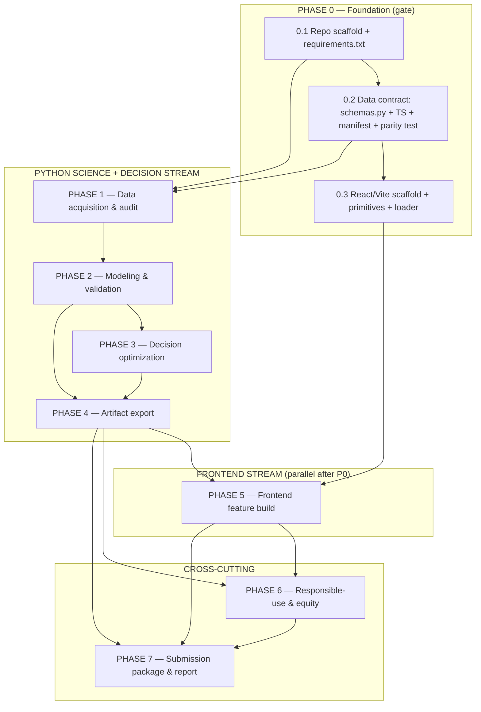

# Implementation Plan: VulneraSafe AI

## Overview

This plan converts the VulneraSafe AI design into incremental coding tasks for a 48-hour hackathon. The architecture is a **static precomputed-artifact system**: a Python analysis layer (`src/`) runs the full pipeline offline and emits versioned artifacts to `web/public/data`; a React/TypeScript/Vite app renders whatever matches the shared schema contract. Because the two layers are joined only by that contract, fixing it first (Phase 0) unblocks two parallel work streams — Python science/decision (Phases 1–4) and frontend (Phase 5) — plus cross-cutting responsible-use enforcement (Phase 6) and the submission package (Phase 7).

Implementation languages are already fixed by the design: **Python** for the analysis/decision layer and **TypeScript/React** for the web app. No pseudocode, so no language-selection step is required.

Property tests map to the twelve Correctness Properties in `design.md` and use **Hypothesis** (Python) at ≥100 iterations; frontend uses **vitest + Testing Library**. Tasks marked with `*` are optional/stretch and are not implemented automatically.

## Parallelization Overview

The graph below shows which work can proceed in parallel. Phase 0 is the gate; after it, the Python science stream and the frontend stream run concurrently and converge at the Phase 4 exporter and Phase 5/6 wiring.



Parallelism summary: **0.2/0.3 unblock everything**; once 0.2 lands, `PHASE 1` (data acquisition + modeling) and `PHASE 5` (frontend scaffold + panels) proceed on separate branches against the fixed contract. The exporter (Phase 4) is the merge point that feeds real artifacts into the frontend.

## Tasks

- [x] 1. PHASE 0 — Project and contract foundation
  - [x] 1.1 Scaffold repository structure and pin dependencies
    - Create `data/{raw,interim,processed,synthetic}`, `src/{pipeline,models,decision,artifacts}`, `web/`, `docs/`, `tests/` with package `__init__.py` files
    - Write `requirements.txt` with pinned versions: scikit-learn, xgboost, lightgbm, shap, pandas, numpy, pyarrow, ortools, pytest, hypothesis, requests
    - Add `.gitignore` keeping tokens/keys and large raw files out of version control; keep `data/raw` and `data/synthetic` as physically separate directories
    - _Requirements: 4.4, 15.4, 18.1_
  - [x] 1.2 Define the Python-to-React data contract and parity test
    - Implement `src/artifacts/schemas.py` TypedDicts for every artifact (manifest, risk_timeseries, risk_map, attention_queue, recommendations, regulatory_alerts, scenario_results, ablation_results, model_metrics, evidence_graph, provenance, equity_test, feasibility_report) with the status-tag field
    - Write matching TypeScript interfaces in `web/src/types/artifacts.ts`
    - Add an example `web/public/data/manifest.json` matching the design's concrete example
    - _Requirements: 14.3, 15.1, 15.5_
  - [ ]* 1.3 Write the schema parity test (Python + web)
    - Shared fixtures generated from the Python TypedDicts; assert TS interfaces and Python TypedDicts stay aligned so the contract cannot silently drift
    - _Requirements: 15.1_
  - [x] 1.4 Scaffold the React/TS/Vite app and artifact-loading layer
    - Set up Vite + React 18 + TypeScript + Tailwind with `base = /VulneraSafe_AI/`, routing, and navy/teal scientific light theme tokens
    - Build shared primitives: `StatusTag` (OBSERVED | PREDICTED | SIMULATED), `AlertBadge` (REGULATORY | MODEL), `EmptyState`
    - Implement the data-loading layer in `web/src/data/` (`useManifest()`, `useArtifact(name)`) reading `/public/data`, validating against TS types, caching in a typed store, and surfacing a named error on load failure while other panels render
    - _Requirements: 12.9, 14.5, 15.1, 15.2, 15.3_
  - [ ]* 1.5 Write loader and primitive render tests
    - Test `StatusTag` renders exactly one tag; `AlertBadge` distinguishes sources; loader graceful-degradation on a missing artifact
    - _Requirements: 14.3, 15.3_

- [x] 2. PHASE 1 — Data acquisition and audit (One Health)
  - [x] 2.1 Implement per-source ingestion with provenance and checksums
    - In `src/pipeline/ingest.py`, implement fetchers for FSIS lab sampling (CSV), FSIS Recall/PHA API (JSON, regulatory track), CDC human-health substitute (NORS/BEAM), NOAA CDO v2 (token via env var), ACS, Food Access Atlas
    - Each fetcher writes a `ProvenanceRecord` (source, URL, ISO 8601 access date, license, coverage, checksum, counts, per-column missingness, known biases) and halts only its own stream on failure/zero records, retaining other streams and recording the error + manual-download instructions in the missingness report
    - Record the FSIS sampling program per dataset for the correct `Program_Denominator`
    - _Requirements: 2.1, 2.2, 2.3, 2.4, 3.7, 4.1, 4.3_
  - [ ]* 2.2 Write property test for checksum integrity
    - **Property 11: Checksum integrity**
    - **Validates: Requirements 4.1, 4.2**
  - [x] 2.3 Enforce data integrity and authenticity rules
    - On checksum mismatch, reject the dataset, report a verification error, exclude from downstream processing
    - On a missing empirical value, record a gap entry in the provenance and report it — never substitute a fabricated, estimated, or placeholder value; placeholders only in SIMULATED datasets, never on empirical ML labels
    - _Requirements: 4.2, 4.5, 4.6_
  - [x] 2.4 Implement the dataset audit module
    - In `src/pipeline/audit.py`, compute per dataset: observation/positive/negative counts, `Positivity_Rate` using the `Program_Denominator`, yearly and quarterly distributions, establishment and location identifiers, record timestamps
    - Compute collection date range, publication date, and reporting delay; run leakage checks (pass/fail + triggering fields); mark an audit incomplete (not omitted) when a required field is unavailable
    - _Requirements: 3.1, 3.2, 3.3, 3.4_
  - [ ]* 2.5 Write property test for positivity-rate math
    - **Property 3: Positivity rate math**
    - **Validates: Requirements 3.1**
  - [ ]* 2.6 Write unit tests for reporting delay and incomplete-audit marking
    - Test delay = publication − collection; test that a missing required field marks the audit incomplete rather than dropping the dataset
    - _Requirements: 3.2, 3.3_
  - [x] 2.7 Implement multi-factor feasibility assessment and per-pathogen resolution
    - In `src/pipeline/feasibility.py`, compute `FeasibilityAssessment` jointly over train positives, test positives, temporal coverage, geographic coverage, achievable calibration, and prediction stability; classify `predictive` iff all required factors pass, else `non_predictive`, recording every factor value and rationale
    - Define `Modeling_Unit` = pathogen × commodity × region × time and select monthly vs quarterly resolution independently per pathogen from its sample availability, recording the evidence
    - _Requirements: 3.5, 3.6, 6.2, 6.3, 6.4_
  - [ ]* 2.8 Write property test for feasibility classification
    - **Property 2: Feasibility classification matches factor conjunction**
    - **Validates: Requirements 3.5, 6.2, 6.3, 6.4**
  - [x] 2.9 Implement harmonization into analytic tables
    - In `src/pipeline/harmonize.py`, build a FIPS county → state/FSIS-region crosswalk, temporally align all sources to the per-pathogen resolution, apply explicit lags to predictor sources, and join on `(region, period)` into `data/processed/` analytic tables
    - Record the decision statement (Decision_Maker, decision, geography, commodity scope, horizon) and reject it naming any missing element; store operational constraints/authority retrievable by Decision_Engine and Web_App
    - _Requirements: 1.1, 1.2, 1.3, 1.5, 2.6, 2.7, 2.8_
  - [x] 2.10 Produce One Health documentation artifacts
    - Emit the One Health system diagram labeling all five pathways (human, food/animal, environmental, supply-chain, food-security) with their datasets; `docs/data_dictionary.md`; `docs/provenance.md` + provenance table; missingness report; temporal/spatial alignment report
    - Record which secondary objective was overridden whenever availability/access/food-loss conflicts with a safety constraint
    - _Requirements: 1.4, 2.5, 2.7, 18.1_

- [x] 3. PHASE 2 — Modeling and validation
  - [x] 3.1 Implement leakage-safe feature construction
    - In `src/pipeline/features.py`, construct features only from data timestamped at or before the horizon cutoff: lagged FSIS positivity/sample counts, CDC signals at/before cutoff, NOAA weather anomalies, seasonal/geographic attributes; exclude any post-cutoff source and record the exclusion for audit
    - _Requirements: 7.4, 7.5, 7.6_
  - [ ]* 3.2 Write property test for no post-cutoff data
    - **Property 1: No feature uses post-cutoff data**
    - **Validates: Requirements 7.5, 7.6, 3.4**
  - [x] 3.3 Define prediction target and fixed horizon
    - Implement binary target (next-horizon positivity exceeds a ≥12-month baseline or stated program threshold) at the `Modeling_Unit`; fix the horizon before tuning; exclude units with insufficient history recording the reason; evaluate one count/rate formulation alongside the binary one and record the selected formulation + rationale; state the target as surveillance risk, never a shipment-contamination claim
    - _Requirements: 5.1, 5.2, 5.3, 5.4, 5.5_
  - [x] 3.4 Implement baseline models
    - In `src/models/baseline.py`, build a seasonal/historical baseline and a regularized logistic model; record each configuration and metrics for comparison
    - _Requirements: 7.1_
  - [x] 3.5 Implement integrated models with rare-event handling
    - In `src/models/integrated.py`, build a gradient-boosting model (XGBoost or LightGBM) and a RandomForest; apply class-weighting/rare-event handling where positive prevalence < 10%; record each configuration and metrics
    - _Requirements: 7.2, 7.3_
  - [x] 3.6 Implement per-pathogen module gating
    - Build Salmonella-in-raw-poultry as the primary predictive module; build Listeria (RTE) and STEC (raw beef) as predictive modules only if their assessment passes, otherwise as `Non-Predictive_Module`s rendering historical surveillance with uncertainty; expose each module's status and feasibility factors
    - _Requirements: 6.1, 6.2, 6.3, 6.4, 6.5_
  - [x] 3.7 Implement time-aware validation and uncertainty
    - In `src/models/validation.py`, run chronological validation as primary (rolling-origin ≥3 origins, train timestamps strictly before test, final 20% untouched); run `Establishment_Holdout_Validation` as a separate secondary check reported independently
    - Report PR-AUC, ROC-AUC, precision, recall, Brier, calibration plot, and 95% intervals — disaggregated per region and per period — plus FP/FN counts/rates and a top-K inspection-budget condition; compute metrics only from exported predictions; record any uncomputable metric as unavailable
    - _Requirements: 8.1, 8.2, 8.3, 8.4, 8.5, 8.6, 8.7_
  - [ ]* 3.8 Write property test for chronological split ordering
    - **Property 4: Chronological split ordering**
    - **Validates: Requirements 8.1**
  - [x] 3.9 Implement interpretation and ablations
    - In `src/models/interpret.py`, produce permutation importance, SHAP attributions, and an error analysis (≥1 accuracy and ≥1 calibration/error-distribution metric on held-out data) per predictive module
    - In `src/models/ablation.py`, run exactly four ablations (FSIS-only, FSIS+CDC, FSIS+NOAA, full) on the same held-out set/metric; report each configuration's signed marginal contribution vs FSIS-only, preserving negative signs
    - _Requirements: 9.1, 9.2, 9.3, 9.4, 9.5_
  - [ ]* 3.10 Write property test for ablation sign preservation
    - **Property 6: Ablation marginal contributions preserve sign**
    - **Validates: Requirements 9.4, 9.5**
  - [x] 3.11 Checkpoint — Ensure Phase 1–2 tests pass
    - Ensure all tests pass, ask the user if questions arise.

- [x] 4. PHASE 3 — Decision optimization
  - [x] 4.1 Implement the seeded Synthetic_Operational_Network generator
    - In `src/decision/synth_network.py`, generate a seeded, documented synthetic retail shipment/inventory dataset stored in isolated `data/synthetic/`, with every record labeled SIMULATED and no record set mixing synthetic and real observational data
    - _Requirements: 4.4, 11.6_
  - [ ]* 4.2 Write property test for synthetic isolation and labeling
    - **Property 9: Synthetic data isolation and labeling**
    - **Validates: Requirements 4.4**
  - [x] 4.3 Implement the OR-Tools CP-SAT optimizer with hard safety constraints
    - In `src/decision/optimizer.py`, model per-lot/per-store actions (at least six: prioritize testing/inspection, request supplier documentation, escalate for human assessment, match lot ids against confirmed recalls, isolate recalled inventory, allocate compliant replacement)
    - Wire hard constraints directly from the regulatory-evidence track (never distribute a confirmed-recall lot; always isolate recalled lots), independent of model uncertainty; optimize secondary objectives only within the feasible region; return each action with product/lot id, triggering condition, and priority rank; on infeasibility return no distribution recommendation plus a "no safety-compliant solution" indicator
    - _Requirements: 10.1, 10.2, 10.3, 10.4, 10.5, 10.6, 10.7, 10.8, 10.9_
  - [ ]* 4.4 Write property test for optimizer safety invariant
    - **Property 5: Optimizer never violates a hard safety constraint**
    - **Validates: Requirements 10.3, 10.6, 10.7**
  - [ ]* 4.5 Write unit test for the infeasible → no-solution case
    - Assert the engine returns no distribution recommendation and the explicit "no safety-compliant solution" indicator when constraints cannot be met
    - _Requirements: 10.9_
  - [x] 4.6 Implement policies A/B/C and three scenarios
    - In `src/decision/policies.py` and `src/decision/scenarios.py`, compare policy A (business-as-usual), B (model-guided safety), C (model-guided safety + food-access-aware) across the three scenarios (Listeria RTE recall + replacement; elevated Salmonella + limited inspection; STEC + limited supply + High_Need_Community)
    - For each policy×scenario report inspection workload, priority-review coverage, retrospective positive-test capture, inventory availability, compliant food delivered, supply disruptions, and High_Need_Community service — each with diff-vs-A and an uncertainty interval; omit an invalid metric with a not-valid indicator; block high-consequence recommendations behind a `Human_Review` gate
    - _Requirements: 11.1, 11.2, 11.3, 11.4, 11.5, 11.7_

- [x] 5. PHASE 4 — Artifact export (Python↔web bridge)
  - [x] 5.1 Implement the schema-validated exporter
    - In `src/artifacts/exporter.py`, validate every artifact against its TypedDict before writing versioned JSON/CSV/Parquet + `manifest.json` (artifact_version, generated_at, per-module status + feasibility) to `web/public/data`; run from fixed seeds so identical inputs produce identical artifacts; emit the `equity_test` artifact (pass/fail + disparity)
    - _Requirements: 8.6, 15.1, 15.5, 16.9_
  - [ ]* 5.2 Write property tests for export invariants
    - **Property 7: Exactly one status tag per displayed value** — **Validates: Requirements 14.3**
    - **Property 10: Reproducible artifacts from fixed seeds** — **Validates: Requirements 15.5**
    - **Property 12: Equity test consistency** — **Validates: Requirements 16.9**

- [x] 6. PHASE 5 — Frontend feature build (parallel with Phases 1–4 after Phase 0)
  - [x] 6.1 Build the five mandatory panels
    - Current Risk Overview (MapLibre choropleth + ECharts/Recharts time-series; selecting a region updates the time-series; empty-state when no data); Prioritized Attention Queue (ranked high→low); Scenario Builder (controls for inspection budget, inventory supply, delays, food-access; reject out-of-range input showing the accepted range and retaining prior valid values); Recommended Action Panel (action, rationale, governing constraints, Human_Review requirement); Explanation/Evidence Panel (source data, uncertainty, limitations)
    - _Requirements: 12.1, 12.2, 12.3, 12.4, 12.5, 12.6, 12.7, 12.8_
  - [ ]* 6.2 Write render tests for the five panels
    - Include empty-state and out-of-range-input behavior; assert region selection updates the time-series
    - _Requirements: 12.2, 12.3, 12.6_
  - [x] 6.3 Build the analytical feature views
    - Multi-pathogen explorer (switch updates maps/trends/evidence/model-status within 3s); `Vulnerable_Population_Lens` (pregnancy & newborns / under-5 / 65+); historical forecast replay (show only data at/before cutoff then reveal later outcomes; reject out-of-range cutoff retaining prior valid); what-if simulator; side-by-side A/B/C policy comparison; evidence-to-action graph (Data→Model→Alert→Evidence→Decision→Impact) via React Flow; supply-chain network view; export control (decline with indicator when nothing is displayed)
    - _Requirements: 13.1, 13.2, 13.3, 13.4, 13.5, 13.6, 13.7, 13.8_
  - [x] 6.4 Build the Regulatory Alerts strip
    - Render verified official recalls from the `regulatory_alerts` artifact in a dedicated, visually distinct strip that is never suppressed by missing model uncertainty and is styled differently from model alerts (AlertBadge source REGULATORY vs MODEL)
    - _Requirements: 16.5, 16.6_
  - [x] 6.5 Implement risk-map labeling, status tagging, and theme rules
    - Label every risk map with pathogen, geography, reporting period, model/surveillance status, uncertainty, and data freshness, showing an explicit not-available indicator for any missing field; tag each value OBSERVED/PREDICTED/SIMULATED; restrict orange/red to active alerts; apply the navy/teal scientific light theme; render no decorative metrics; show empty-state and artifact-load-failure indications
    - _Requirements: 12.3, 14.1, 14.2, 14.3, 14.4, 14.5, 14.6, 15.3_
  - [ ]* 6.6 Write frontend integration test for static-app guarantee and parity
    - Assert no runtime fetch to a non-local origin; assert TS interfaces match the artifact schemas via shared fixtures
    - _Requirements: 15.2_

- [x] 7. PHASE 6 — Responsible-use, equity, and guardrails
  - [x] 7.1 Enforce responsible-interpretation constraints across both layers
    - Present the system as decision support only (never a regulatory determination/outbreak declaration); never infer contamination from a model alone, declare a product safe/unsafe from predicted risk alone, infer causal linkage from genomic/temporal similarity, or infer individual medical status from demographics
    - For every displayed recommendation show supporting evidence, a quantified uncertainty measure, and a Human_Review indication; withhold (Python at export, UI never renders) any MODEL recommendation lacking uncertainty or evidence with an explanatory indicator; label each performance measure historical vs prospective and never report a benefit exceeding the evaluation value
    - _Requirements: 16.1, 16.2, 16.3, 16.4, 16.5, 16.7, 16.8_
  - [ ]* 7.2 Write property tests for regulatory independence and equity
    - **Property 8: Regulatory alerts are independent of model uncertainty** — **Validates: Requirements 16.5, 16.6**
    - **Property 12: Equity test consistency** — **Validates: Requirements 16.9**

- [ ] 8. PHASE 7 — Submission package and report
  - [x] 8.1 Add GitHub Pages deployment workflow
    - Add a GitHub Actions workflow building the Vite app (base `/VulneraSafe_AI/`) and deploying to `gh-pages` using only free-tier services; do not claim deployment until verified
    - _Requirements: 15.2, 15.4, 18.7_
  - [x] 8.2 Finalize data dictionary and provenance file
    - Complete `docs/data_dictionary.md` (every column, type, units) and `docs/provenance.md` (per-source origin, retrieval date, license)
    - _Requirements: 18.1_
  - [x] 8.3 Author the PDF report sources
    - In `docs/reports/`, produce report sources with dedicated sections for methods, results, model validation, uncertainty, figures, scenario comparison, team science, and limitations, and an identifiable response to each of the ten final-report questions; flag any unanswered question rather than presenting the report as complete
    - _Requirements: 18.3, 18.4, 18.5_
  - [x] 8.4 Author the team science statement
    - In `docs/team_science.md`, document real team members and genuine contributions mapped to disciplines, flag uncovered disciplines as gaps, document at least two added datasets, a genuine added-data ablation with a quantitative metric and difference, at least one real decision changed by a real team member/stakeholder, and at least one future-partner/dataset recommendation within one page; exclude anything not traceable to a real source
    - _Requirements: 17.1, 17.2, 17.3, 17.4, 17.5, 17.6_
  - [x] 8.5 Write README, reproducibility list, and AI-assistance disclosure
    - Author `README.md` with build/deploy instructions and a reproducibility requirements list; disclose AI-assisted work; verify the six submission components are present and identify any missing component rather than presenting the package as complete
    - _Requirements: 18.1, 18.2, 18.6_
  - [x] 8.6 Final checkpoint — run full verification suite
    - Run `pytest` (including Hypothesis property tests) and the frontend parity + render tests; ensure all pass; ask the user if questions arise
    - _Requirements: 8.6, 15.1_

## Notes

- Tasks marked with `*` are optional/stretch (all test sub-tasks) and can be skipped for a faster MVP; core implementation tasks are never optional.
- Every task references specific requirement sub-clauses for traceability; all requirements 1–18 are covered by at least one task.
- Property-test sub-tasks reference the exact Correctness Property from `design.md` (Properties 1–12) and the requirements each validates.
- Checkpoints (3.11, 8.6) provide incremental validation at phase boundaries.
- Phase 0 is the hard gate: once the contract (1.2) lands, the Python science stream (Phases 1–4) and the frontend stream (Phase 5) run in parallel and converge at the exporter (Phase 4) and guardrail wiring (Phase 6).

## Task Dependency Graph

```json
{
  "waves": [
    { "id": 0, "tasks": ["1.1"] },
    { "id": 1, "tasks": ["1.2"] },
    { "id": 2, "tasks": ["1.3", "1.4", "2.1"] },
    { "id": 3, "tasks": ["1.5", "2.2", "2.3", "2.4"] },
    { "id": 4, "tasks": ["2.5", "2.6", "2.7", "2.9"] },
    { "id": 5, "tasks": ["2.8", "2.10", "3.1", "6.1"] },
    { "id": 6, "tasks": ["3.2", "3.3", "3.4", "3.5", "6.2", "6.3"] },
    { "id": 7, "tasks": ["3.6", "3.7", "6.4", "6.5"] },
    { "id": 8, "tasks": ["3.8", "3.9", "4.1", "6.6"] },
    { "id": 9, "tasks": ["3.10", "4.2", "4.3"] },
    { "id": 10, "tasks": ["4.4", "4.5", "4.6"] },
    { "id": 11, "tasks": ["5.1"] },
    { "id": 12, "tasks": ["5.2", "7.1"] },
    { "id": 13, "tasks": ["7.2", "8.1", "8.2", "8.4"] },
    { "id": 14, "tasks": ["8.3", "8.5"] },
    { "id": 15, "tasks": ["8.6"] }
  ]
}
```
